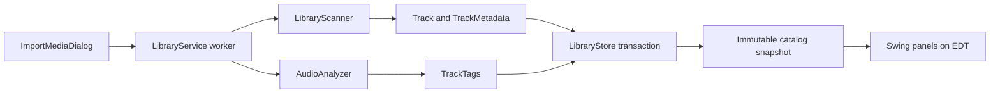

# Learning Sangitam's implementation

This guide follows the code that exists in this checkout. Start with one imported song, then follow its data into storage, editing, search, and playback. The [handoff](PROJECT_HANDOFF.md) tracks remaining work; this guide explains how the implemented parts fit together.

## 1. A reading path

| Question | Start here | What to notice |
|---|---|---|
| How does the program start? | [SangitamApp](../src/sangitam/desktop/app/SangitamApp.java) | Swing construction is scheduled with `invokeLater`; workspace loading follows the first paint. |
| How do screens call the application? | [MainFrame](../src/sangitam/desktop/ui/MainFrame.java) | It supplies callbacks to panels and connects services. |
| What is a song? | [Track](../src/sangitam/desktop/model/Track.java), [TrackMetadata](../src/sangitam/desktop/model/TrackMetadata.java) | Immutable records describe one file and its optional metadata. |
| How is a file imported? | [LibraryScanner](../src/sangitam/desktop/library/LibraryScanner.java), [LibraryService](../src/sangitam/desktop/library/LibraryService.java) | Reading files and analyzing audio happen in workers. |
| How are edits preserved? | [LibraryStore](../src/sangitam/desktop/storage/LibraryStore.java), [MetadataStore](../src/sangitam/desktop/storage/MetadataStore.java) | Transactions and explicit overrides protect user corrections. |
| How do I follow file tags again? | [Home and restoration walkthrough](HOME_AND_METADATA_RESTORE.md) | Explicit field selection, successful reads, and one transaction release selected overrides. |
| How does Home stay bounded? | [HomeLibraryData](../src/sangitam/desktop/ui/HomeLibraryData.java), [LibraryDashboardStore](../src/sangitam/desktop/storage/LibraryDashboardStore.java) | Small shelves and versioned cover caches keep renderers free of I/O. |
| How does search page results? | [LibrarySearchStore](../src/sangitam/desktop/storage/LibrarySearchStore.java), [SearchPanel](../src/sangitam/desktop/ui/SearchPanel.java) | SQLite returns bounded pages; Swing rejects obsolete worker results. |
| How does a smart playlist update itself? | [SmartPlaylistRule](../src/sangitam/desktop/model/SmartPlaylistRule.java), [SmartPlaylistStore](../src/sangitam/desktop/storage/SmartPlaylistStore.java) | A saved rule computes a limited path snapshot from current catalog data. |
| How does audio change? | [PlayerService](../src/sangitam/desktop/playback/PlayerService.java), [VlcjPlayerService](../src/sangitam/desktop/playback/VlcjPlayerService.java) | The interface separates UI intent from decoder commands. |

The project separates responsibilities by package. A Swing panel should not open SQLite connections. A scanner should not change labels. A decoder should not decide which playlist to play next. Those boundaries make each part easier to test and replace.

## 2. Follow one song through import



For example, imagine a file called `Piano Sonata in C sharp minor, Op. 27 No. 2.mp3` in a Classical directory.

1. `ImportMediaDialog` passes selected paths to `LibraryService.importMedia`.
2. `LibraryScanner` walks the selected source and deduplicates canonical file paths. It checks size and modification time before rereading a known file.
3. Jaudiotagger reads title, artist, album, genre, classical credits, and the audio header. Existing usable file labels take priority. The earlier `tmp` repair uses alternate MP3 tags and then the filename.
4. `ClassicalHints.enrich` fills missing fields from explicit text. This example can provide form, key, opus, and piano instrumentation. Hints carry their origin. The rules do not identify musicians from sound or assign a historical period from a composer's name.
5. `AudioAnalyzer` separately estimates energy and activity. These are measurements, not classical credits.
6. `LibraryStore.saveScan` saves the scan, availability, sources, and analysis together. It preserves manual overrides.
7. `LibraryService` publishes a new immutable catalog to Swing after the transaction succeeds.

The normalized path is the database identity. `Track` is a record, so Java's generated `equals` compares all its components, including metadata. That is useful for detecting changed scan results. Code that deduplicates songs uses the path, since two snapshots of the same file can have different metadata.

### Why two different kinds of movement?

`TrackTags.activity` is the estimated movement of the sound, used in mood sessions. `TrackMetadata.Field.MOVEMENT` is a named part of a classical work, such as `I. Allegro`. These have different meanings and storage paths.

## 3. Model optional metadata without inventing facts

`TrackMetadata` contains:

- A map from `Field` to `Value`: composer, conductor, soloist, performers, orchestra, album artist, work, movement, key, opus/catalogue, period, form, and instrumentation.
- An origin for each value: file tag, title hint, folder hint, or user edit.
- Custom tags, independent of genre and measured mood scores.
- Bitrate, sample rate, bit depth, channel description, and whether embedded artwork was indexed.
- An extraction version used to refresh older catalog entries.

The map lets a file omit fields it does not have. It also avoids adding a large constructor parameter list every time a new optional role is introduced. The record constructor copies collections, so callers cannot mutate a published snapshot.

Generic performer tags are stored as performers. They are not automatically called soloists. A composer-folder hint is recorded as a folder hint, preserving the distinction between an inferred label and an embedded credit.

`ClassicalHints` is a pure function: give it a path, title, genre, and embedded fields; it returns enriched fields. It performs no network requests or file reads. This makes conservative rules easy to test. Embedded values use `putIfAbsent` priority when adding hints.

`TagVocabulary` provides more than 100 suggestions. It is a vocabulary for the user, not a claim that the analyzer recognized all those genres, instruments, or moods. Users can also write their own comma-separated tags. Tags are trimmed and deduplicated without regard to case.

## 4. Preserve edits across rescans

The original `tracks` table keeps the stable path, basic labels, availability, analysis, and history counters. The new `track_metadata` table stores one optional JSON payload and one normalized search string per path. JSON is useful here because the optional field map can grow without adding a column for every role.

The payload includes the metadata and override flags. Those flags matter more than whether a string is nonempty.

| Existing state | New file value | Value after rescan |
|---|---|---|
| Automatic composer A | Composer B | Composer B |
| User corrected composer A | Composer B | User correction A |
| User explicitly cleared conductor | Conductor B | Empty conductor |
| Automatic technical bitrate 128 | Bitrate 320 | Bitrate 320 |
| User replaced custom tags | Different imported tags | User tags |

Read `MetadataStore.scan` in this order:

1. Load the previous saved payload.
2. Start with freshly scanned metadata, including current technical properties.
3. Overlay only the fields marked as user overrides.
4. Preserve user tags if their replacement flag is set.
5. Save the merged payload and rebuild its search text using the same database connection.

`LibraryStore.saveScan` owns that transaction. A helper sharing its connection cannot accidentally commit only half the scan. Detail editing follows the same rule: update the basic fields and optional metadata, then commit together.

### Missing, null, and empty have different meanings

`DetailChanges.metadata` is a patch map. A missing key leaves that role alone. A present key with an empty string explicitly clears it and protects that clearing from future rescans.

For custom tags, `null` means leave them alone; an empty set means clear them. The collection editor asks which classical fields to apply and whether to replace tags across every selected track. This prevents opening an album with mixed composers and accidentally replacing all its credits with a blank field.

`TrackDetailsPanel.changes()` creates this patch; it does not write to disk. `MainFrame` confirms it and calls `LibraryService.editDetails`, which performs storage work in a worker.

### Migration and startup refresh

`LibraryStore.initialize` uses additive schema changes and `CREATE ... IF NOT EXISTS`. Existing paths, playlists, and listening history survive. A delete trigger removes optional metadata when a catalog track is removed, while playlist and history references keep their original paths.

Old tracks load with an empty metadata value at extraction version zero. `LibraryService.needsMetadataRefresh` compares that with `TrackMetadata.CURRENT_VERSION`. Startup can therefore reread their metadata even when size and modification time have not changed. This refresh does not register new import sources and still respects manual title/artist corrections.

Malformed saved metadata is reported as an error instead of silently replacing user corrections with empty values.

## 5. Search a bounded page

The Search screen queries SQLite instead of filtering a full copied track list. Its request has a query, category, availability filter, sort order, offset, and page size. The UI requests 100 rows; the storage API rejects limits above 250.

`LibrarySearchStore.search`:

1. Ensures the schema exists, away from Swing's event thread.
2. Builds SQL structure from enums for category and sort order.
3. Binds the user's query with a prepared statement.
4. Escapes `%`, `_`, and backslash so a literal search does not become a wildcard expression.
5. Runs a count and the requested page within one read transaction, so both describe the same database snapshot.
6. Returns an immutable `Page` containing only those hits.

Songs search normalized labels, classical fields, and custom tags. Album/artist searches group the matching songs. Opening a group opens its full collection in the main pane. The group count describes tracks matching the current query. Unknown album/artist groups are omitted; their songs remain searchable.

The order includes deterministic tie breakers. For example, two songs with the same title and artist use their path to establish a stable order. Without this, equal sort values can create confusing page boundaries.

The implementation uses substring `LIKE` search, not an inverted full-text index. Leading-wildcard queries can scan the database. Sorting indexes help appropriate unfiltered queries, but paging does not make every query constant-time. Legacy rows without normalized metadata temporarily use SQLite's basic lowercase fallback; full Unicode case folding is available once their normalized search text is created. SQLite's album/artist grouping uses its built-in `NOCASE` rules.

### Prevent old results from winning

Suppose the user types `sonata`, then immediately changes it to `concerto`. The sonata query might finish last.

`SearchPanel` increments a generation number as soon as input changes, clears the old rows, and disables page buttons. A 180 ms debounce reduces unnecessary queries while typing. Each worker captures its generation. `done()` publishes only if the worker is current and not cancelled. SQLite's progress handler also checks interruption during long queries.

This is a small concurrency lesson: cancellation saves work when possible; a generation check protects correctness even if cancellation arrives late.

`close()` stops timers and cancels the active worker. The same lifecycle discipline prevents a closed screen from receiving stale updates.

## 6. Keep Swing responsive

Swing's Event Dispatch Thread (EDT) handles input and painting. It should do short component updates. File decoding, SQLite transactions, analysis, and network requests belong elsewhere.

| Work | Where it runs |
|---|---|
| Construct panels, read editor controls, show results | Swing EDT |
| Import, rescan, metadata edits, catalog snapshots | `LibraryService` Swing workers |
| Search SQL | `SearchPanel` worker through `LibrarySearchStore` |
| Native VLC commands and status samples | Single decoder executor |
| JavaFX media commands | JavaFX application thread |
| Audio settings file reads/writes | Swing workers |

`SwingWorker.doInBackground()` performs work; `done()` and `process()` update Swing. Immutable snapshots make the thread boundary easier to reason about because a worker cannot later modify the collection a renderer is using.

## 7. Understand the EQ and volume correction

The UI calls `PlayerService`; it does not touch libVLC or JavaFX directly.

`LiveAudioPreview` sends the first EQ edit immediately, then coalesces drag events every 30 ms. A restart-on-every-event debounce would wait until dragging stopped, which is wrong for live audio feedback. Cancel discards queued edits before restoring saved settings.

Volume uses VLC-style ratios: `0` is mute, `1` is 100%, and `1.5` is 150%. VLC receives the matching integer percentage. Its Windows volume curve is cubic; the JavaFX fallback uses that curve below its 100% limit. Thus `linear(0.5)` is `0.125`, and `linear(1.5)` is `3.375` where native boost is supported.

VLC 3's single-pass EQ multiplies its dry signal by `0.25`. Sending its raw preamp a value of zero therefore dropped a flat signal by about 12 dB. `AudioGain.vlcEqualizerPreamp` adds `20 * log10(4)` before the user's attenuation to offset that factor. The application displays the user's actual preamp value. There is no automatic attenuation equal to the largest boosted band.

The silent PCM test verifies the result numerically: flat EQ preserves level, a boosted 1 kHz band increases a 1 kHz tone, and manual −6 dB preamp reduces it by approximately 6 dB. This caught a defect that inspecting slider values alone did not reveal.

ReplayGain is separate from EQ. It reads existing file tags through VLC, uses peak protection, and takes effect at the next track start after Save. Untagged files use zero default gain. Its factory options are changed between tracks so saving a mode does not restart the current song.

## 8. Learn through the tests

From the repository root, PowerShell:

```powershell
.\build.bat
.\mvnw.cmd test
.\mvnw.cmd '-Dtest=ClassicalHintsTest,MetadataStoreTest,LibrarySearchStoreTest,TrackDetailsPanelTest,SearchPanelTest' test
```

The ordinary suite is headless. Component tests construct panels and change their controls in memory with `SwingUtilities.invokeAndWait`; they do not open app windows or take over the desktop.

| Test | Behavior to read for |
|---|---|
| `ClassicalHintsTest` | Conservative inference, origins, embedded priority, flexible tags |
| `LibraryScannerTest` | Real tagged MP3 import and separate composer/conductor/performer credits |
| `MetadataStoreTest` | User edits and explicit clears survive reimport; metadata cleanup preserves history |
| `LibraryServiceTest` | Import-to-Swing flow and metadata upgrade of a legacy row |
| `LibrarySearchStoreTest` | Stable pages, availability, literal query characters, Unicode metadata, grouping |
| `TrackDetailsPanelTest` | One edited credit creates a narrow patch; mixed collections require Apply |
| `SearchPanelTest` | Background queries, Next-page playback, late-result rejection |
| `LiveAudioPreviewTest` | Immediate edit, continued drag updates, cancellation |
| `SmartPlaylistStoreTest` | Dynamic membership, rule persistence, manual-write protection, and fixed copies |
| `SmartPlaylistPanelTest` | Rule validation, committed numeric edits, preview cancellation, and retry |
| `SmartPlaylistLibraryTest` | Smart context actions and safe drop destinations without desktop input |
| `DetailResetTest`, `DetailResetPanelTest` | Explicit restoration, released overrides, preserved unrelated edits, and rollback |
| `LibraryDashboardStoreTest`, `HomeLibraryPanelTest` | Actual recent listening, bounded pinned membership, and keyboard callbacks |
| `LibraryArtworkTest` | Versioned positive/negative caches, off-EDT reads, and close lifecycle |

Two optional checks do not control the desktop:

```powershell
.\mvnw.cmd '-Dtest=CatalogBenchmarkTest' '-Dsangitam.catalogBenchmark=true' test
.\mvnw.cmd '-Dtest=AudioEngineIntegrationTest#nativeEqHasNoAutomaticAttenuationAndBoostsSelectedBand' '-Dsangitam.nativeAudioTests=true' test
```

The benchmark generates 100,000 SQLite rows with fake file paths; it creates no music files. One run measured count-plus-page queries at approximately 99–177 ms with at most 100 loaded songs. That is a local synthetic measurement, not a whole-app performance guarantee. General, Locations, dashboards, and session planning still use catalog snapshots.

The selected native test requires installed VLC and captures decoded samples in memory without speaker output. Other native integration methods exercise real playback; do not confuse that broader suite with the silent check.

## 9. Follow the smart playlist implementation

Smart playlists are now implemented as saved rules alongside regular playlist identities. They update after imports, edits, availability changes, and recorded plays. The UI offers preview, editing, moving/pinning, and a regular snapshot copy; active queues keep their captured order.

Read [the smart playlist walkthrough](SMART_PLAYLISTS.md) for the complete path from the editor through validation, versioned JSON, prepared SQL, Unicode tag matching, bounded previews, and catalog-driven refreshes. It also explains why both UI drop policy and storage methods protect rule ownership.

## 10. Small exercises and remaining work

Try these changes in increasing order of difficulty:

1. Add a custom tag suggestion and check that arbitrary user labels still work.
2. Add a conservative title rule with a positive and a misleading counterexample. Confirm an embedded value still wins.
3. Add a metadata field, trace it through scanning and editing, and test persistence. If old files need rereading, consider the extraction version.
4. Add a search filter using bound parameters and ensure changing it resets the page offset.
5. Extend smart playlist rules with a new condition, deciding how old saved JSON should migrate and adding tests for preview and resolved membership.

Home's recently played and pinned-playlist artwork rows and selective restoration of file details are now wired. Read [Home and metadata restoration](HOME_AND_METADATA_RESTORE.md) for the data flow, override-release transaction, versioned cover cache, and headless checks.

Read [Playbar, artists, and shortcuts](PLAYBAR_ARTISTS_AND_SHORTCUTS.md) for the next continuation: shared transport actions, scrolling titles and role links, offline profiles, measured listening time, queue/history, live EQ editor behavior, optional Windows SMTC IPC, real JavaFX spectrum, and saved configurable app bindings. It includes source links, headless checks, and the limits that still require runtime work.

General now publishes bounded snapshot pages and Locations loads branch windows on demand. Read [Library presentation paging](LIBRARY_PRESENTATION_PAGING.md) for the page/membership distinction, worker generations, lazy-node lifecycle, restoration, tests, and measured limits. Full catalog storage remains resident.

The roadmap still includes database-backed browsing for the remaining library views, opt-in MusicBrainz/artist enrichment, richer audio analysis and mood curves, crossfade/gapless work, remaining menu implementations, VLC spectrum, analytics, and Windows packaging. Provider audio is restricted to integrations that officially permit playback; catalog links are not local audio files. Read the handoff before choosing the next item.

Manual visual and interaction verification remains pending for the latest editor, search, smart-playlist, restoration, Home, playbar/artist/shortcut screens, and Windows media integration. The current work was checked through source, headless components/offscreen images, and protocol-only companion execution without desktop control.

## Artist enrichment and listening journeys

Follow a public artist lookup from the playbar through the local alias and portrait cache, then follow the local audio samples and listening context into a playable journey. [Artist enrichment and mood sessions](ARTIST_ENRICHMENT_AND_MOOD_SESSIONS.md).

## Windows launch and scale testing

Follow the console-free launcher, startup milestones, catalog workers, and synthetic test library. [Windows launcher and scale test](WINDOWS_LAUNCH_AND_SCALE_TEST.md).
