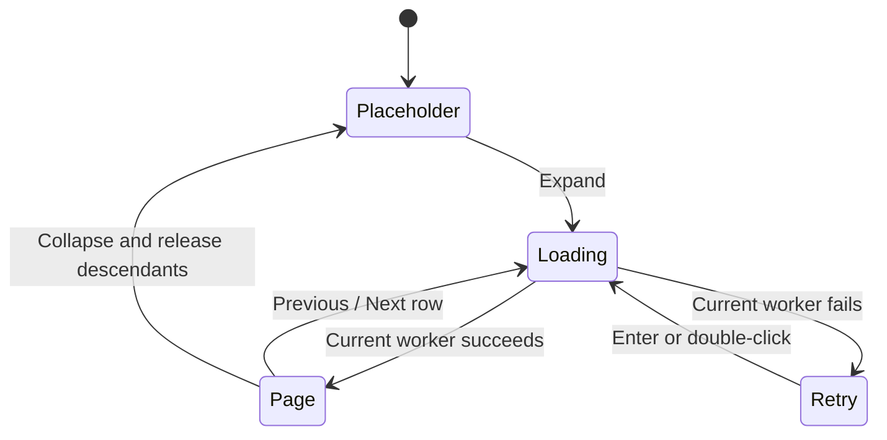

# Learning bounded library presentation

This roadmap continuation improves General and Locations without changing SQLite schemas, saved playlist IDs, media paths, or the playback queue. It bounds what Swing displays and moves recurring search/order work off its Event Dispatch Thread (EDT). It retains the existing full catalog and mixed-entry snapshots; a future database-backed browser must address those separately.

## 1. Separate data membership from displayed rows

Read [LibraryEntry](../src/sangitam/desktop/ui/LibraryEntry.java) and [GeneralLibraryPages](../src/sangitam/desktop/ui/GeneralLibraryPages.java).

A `LibraryEntry` contains complete ordered membership. An album with 130 songs keeps all 130 even when only 100 **entries** are shown in General. Context actions must continue to play, queue, restore, remove, or copy the complete collection. Slicing every entry's tracks would silently change those actions.

`GeneralLibraryPages.Request` contains the query, virtual-folder scope, order, and offset. Its query method:

1. Applies the existing root/nested-folder rules and literal case-normalized search, including a song's classical details/custom tags.
2. Keeps pins first, then orders by recent activity, name, or play count.
3. Adds kind and identity ties so paging stays deterministic.
4. Counts matches and selects a 100-entry slice.
5. Clamps an obsolete offset to the last valid page after removals.

The method runs on a worker. Its filtering/sorting still uses a complete in-memory list and temporary matching references. A bounded result is not the same as a bounded database query. Song/album/playlist/folder membership is never reduced to the displayed page.

## 2. Guard asynchronous work at the UI boundary

In [LibraryPanel](../src/sangitam/desktop/ui/LibraryPanel.java), catalog/organization changes build complete mixed entries on one worker, then request a page on another. A query, sort, or folder change resets the offset. A catalog refresh preserves it, subject to clamping.

Text changes invalidate the current generation immediately, clear visible rows, disable navigation, and restart a short debounce. Waiting until the debounce fired would let an older request publish during that delay. Cancellation reduces wasted work; generation/worker checks decide whether a result is still valid. `LibraryEntry.build` and page filtering check interruption as well.

Only `done()` updates Swing models/buttons. Footer text gives the entry range and total; its tooltip includes total tracks and unavailable files. Previous/Next and focused-list Alt+Page Up/Down request another page. Retry is explicit after failure, and closing cancels work.

`trackMenu` constructs a complete single-song entry directly, so Search, the playbar, and artist/history pages do not depend on that song being on the current General page. Existing full entry lookup supports other off-page collection navigation.

## 3. Build an index without building every Swing node

[LocationIndex](../src/sangitam/desktop/ui/LocationIndex.java) consumes indexed `Track` paths. It never lists directories, checks file existence, or opens audio. Thus disconnected drives still appear from the catalog with their unavailable state.

For each filesystem root it finds the common imported folder, retains parent/child folder relationships, and groups songs at their exact parents. Child folders sort before direct songs. Search is literal and includes paths, album/song/artist labels, classical fields, and custom tags. The index stores ordinary immutable paths/lists, not `DefaultMutableTreeNode` objects.

`page(parent, offset)` returns at most 100 direct children. `offsetToward(parent, selection)` finds the page containing the next child toward a restored selection. Both are used by workers, including later-page selection restoration. The index still holds all matching paths/tracks and needs to be rebuilt after a catalog/query change.

## 4. Understand the lazy tree lifecycle

Read [LibraryFolderTree](../src/sangitam/desktop/ui/LibraryFolderTree.java):



Each folder begins with a placeholder so Swing shows its expand affordance. Expanding requests a child page. A page contains at most 100 data nodes, plus Previous/Next rows as needed. Navigation rows use their own action type; they are not songs or folders, so playback and context menus cannot mistake them for media.

Page changes replace children rather than append indefinitely. Collapsing cancels descendant requests, removes their node references, and leaves one placeholder. Expanded folder paths and selection are retained independently. Reindexing can reopen visible branches and load the later page toward a selected path. A structural-change guard prevents programmatic node replacement from being interpreted as a user collapse.

Tree/index generations reject old searches, while per-branch worker identity prevents an old child-page result from replacing a newer page. Retry works for both index and child-page failures. Closing cancels index/branch jobs and ignores late completions.

The bound is **per branch page**. Opening many folders can still load many nodes. Full catalog/index snapshots remain resident. This is an incremental presentation milestone, not a claim that the entire app has constant memory usage.

## 5. Read the evidence and its limits

```powershell
.\build.bat
.\mvnw.cmd test
.\mvnw.cmd '-Dtest=GeneralLibraryPagesTest,LocationIndexTest,LibraryFolderTreeTest,LibraryPagingPanelTest,LibraryFolderTreeLazyTest' test
.\mvnw.cmd '-Dtest=LibraryBrowseBenchmarkTest' '-Dsangitam.catalogBenchmark=true' test
```

- `GeneralLibraryPagesTest`: page coverage without duplicates, pins, deterministic order, recency/plays, scope, literal Unicode/percent searches, clamping, and full collection membership.
- `LibraryPagingPanelTest`: Next-page playback targets that page's song, filtering resets navigation, and refreshed catalog data stays filtered. Its preview paints components in memory.
- `LocationIndexTest` / `LibraryFolderTreeTest`: exact parent nesting, folder-before-song ordering, bounded windows, later-page lookup, metadata/path search, and nonexistent paths.
- `LibraryFolderTreeLazyTest`: actual headless tree activation, later-page selection restoration, collapse eviction/reopen, deliberately late old results, and retry after an injected failure.
- `LibraryRailTest` and smart-playlist tests remain regression coverage for expanded library layout, menus, and drop rules.

One synthetic run used 100,000 tracks in a single nonexistent folder. Building the mixed-entry snapshot took 109.3 ms. General's first and last alphabetical pages took 25.7 ms and 7.2 ms, publishing 100 entries each. Building the path index took 163.5 ms. Opening the initial location branch created **103 nodes**: hidden root, folder, 100 songs, and Next. No music files or desktop windows were created.

These are single-run in-memory presentation measurements. They exclude database loading, audio decoding, artwork decoding, real storage/network paths, full application startup, native UI interaction, and peak-memory profiling. The separate `CatalogBenchmarkTest` measures SQLite Search/smart playlists. Do not substitute either benchmark for a whole-app scalability guarantee.

For the next database-browsing stage, preserve the same identity/scope/order contracts, introduce storage-backed summaries and lazy full membership for actions, then remove reliance on the complete mixed snapshot. Add migration and end-to-end action tests before changing that boundary. Manual Windows interaction/visual QA remains pending under the user's no-desktop instruction.
