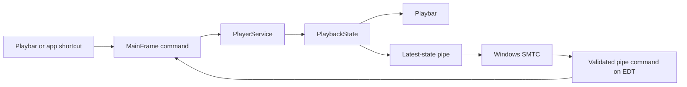

# Learning the playbar, artist pages, and configurable shortcuts

This continuation connects presentation to shared application commands. It includes the playbar overhaul and the next Stage 2 item, configurable app shortcuts. Source and headless tests are complete for those paths; interactive Windows/audio verification remains pending under the user's no-desktop instruction.

## 1. Start from an action, not a decoder call

Read [PlayerBar](../src/sangitam/desktop/ui/PlayerBar.java), then its `Actions` implementation in [MainFrame](../src/sangitam/desktop/ui/MainFrame.java). A Play button, app shortcut, or Windows transport event reaches the same application operation. The panel never opens an audio file or SQLite connection. `PlaybackState` returns the decoder's actual status, duration, and position to the UI.

The playbar contains a 64-pixel cover/music fallback, a long title link, role-ordered musician links, distinct 28-pixel Play/Pause symbols in a prominent button, shuffle/repeat/stop/skip controls, three time values, a mini saved EQ curve, spectrum/queue buttons, mute, and percentage volume. The pause icon previously used fixed-width bars that overlapped at small sizes; its geometry now scales with icon size.

[MarqueeButton](../src/sangitam/desktop/ui/MarqueeButton.java) paints the entire title in a clipped area and scrolls only when it exceeds the available width. Its timer starts/stops with Swing attachment, and a changed title restarts the reading pause. It remains a JButton for keyboard navigation and exposes the full title as a tooltip. [RoundSliderUI](../src/sangitam/desktop/ui/RoundSliderUI.java) styles both seek and volume. Seek sends a command on release; volume sends continuously. Programmatic playback snapshots do not accidentally seek.

## 2. Turn credits into artist identities

[ArtistCredits](../src/sangitam/desktop/model/ArtistCredits.java) deduplicates names in this order: composer, conductor, soloist, performers, orchestra, album artist, remaining artist. Identity uses whitespace normalization and Locale.ROOT case folding. It splits explicit semicolons and spaced slashes, preserving commas in names such as `Bach, Johann Sebastian`. It does not infer that “Bach” and a full name are the same person. If an embedded tag combines multiple people with ambiguous commas, correct or separate those credits in Edit details.

Clicking the title/cover opens its local album group, using the existing album-plus-credited-artist identity. A song with no tagged album opens its details editor. Clicking a credit opens [ArtistPanel](../src/sangitam/desktop/ui/ArtistPanel.java), even if that person only appears in a composer or conductor field.

[ArtistPageData](../src/sangitam/desktop/ui/ArtistPageData.java) prepares these local sections on a worker:

- Ten featured tracks ordered by local play count, with deterministic title/path ties.
- Liked tracks, using existing SONG pins; the playbar heart edits the same pin.
- Albums featuring that person, including the complete matching local album group.
- Up to twelve collaborators, ranked by how many indexed tracks share their credits.

The hero presents a local portrait, full name, device listening duration, expandable notes, and Play/Shuffle. A solid dark background keeps text legible. The content below shows popular tracks, likes, albums, and collaborators. The album list describes the user's local collection, not a complete or globally ranked discography. An online link prefills Discover; the user explicitly chooses a provider/search before any catalog request. Provider results remain metadata and links.

## 3. Save a profile without depending on the internet

[ArtistStore](../src/sangitam/desktop/storage/ArtistStore.java) adds `artist_profiles` to the existing database. Descriptions and resized portrait bytes are local, independent of the source image path. The editor accepts up to 20,000 description characters. Image reads/decoding happen on a worker, reject files over 8 MB or dimensions over 12,000 pixels, subsample, and produce a 320-pixel PNG stored as a BLOB. Deleting/moving the selected source image does not remove the saved portrait.

The biography starts collapsed. Read more exposes the full text with scrolling for long notes. Opening an artist can now fill a local cache from Wikipedia and Commons, and the manual profile editor takes priority. See the [enrichment walkthrough](ARTIST_ENRICHMENT_AND_MOOD_SESSIONS.md) for matching, image attribution, and offline behaviour. Custom background images remain future work.

## 4. Measure listening rather than multiplying plays by duration

A track can be skipped after thirty seconds, replayed, or seeked. A play count is not a listening-time measurement. [ListeningClock](../src/sangitam/desktop/history/ListeningClock.java) measures monotonic elapsed time while playback reports Playing. Seeking to minute ten does not add ten minutes. Pauses add no time, and long stalls are capped per observation.

MainFrame batches deltas every ten seconds to [PlaybackMemoryService](../src/sangitam/desktop/storage/PlaybackMemoryService.java). `ArtistStore` keeps per-path seconds and normalized credit mappings in one transaction. The mappings retain artist attribution after catalog removal. Future listening with corrected credits updates that path's attribution. Artist pages flush pending deltas through the serial memory worker before reading totals. Legacy plays are not backfilled with guessed minutes. These measurements begin with this feature and are device-local.

Volume uses a separate app_state value. Changes submit audio commands immediately and debounce only the database writes. [CoalescedCommand](../src/sangitam/desktop/playback/CoalescedCommand.java) bounds redundant jobs while a slider is dragged and applies the latest shared value. This is a scheduling improvement, not a measured audible-latency guarantee. On normal close the frame disposes and the non-daemon persistence worker drains final writes instead of being killed by System.exit.

## 5. Keep EQ and spectrum honest

[AudioSettingsPanel](../src/sangitam/desktop/ui/AudioSettingsPanel.java) owns testable controls, live preview, Save, and Cancel. [AudioSettingsDialog](../src/sangitam/desktop/ui/AudioSettingsDialog.java) supplies the modal window. Bands and preamp stay interactive while bypassed; moving one turns EQ on. Programmatic load/reset uses an updating guard so it does not accidentally enable EQ. Presets enable EQ explicitly. Save writes preferences on a worker; Cancel drops pending preview edits and restores the original curve. ReplayGain remains Save-only and is explained in the question-mark tooltip. The playbar mini curve shows saved settings.

The optional [SpectrumPanel](../src/sangitam/desktop/ui/SpectrumPanel.java) consumes real JavaFX magnitudes copied before delivery to Swing. Requests detach when hidden, callbacks reject an obsolete player/listener, and pause/stop clears old bars. The current VLC adapter has no sample feed and shows an explicit unsupported message. It does not animate random bars or replace VLC's audio output to obtain samples. VLC spectrum and live native audio measurements remain open.

## 6. Connect Windows without duplicating controls

[WindowsMediaBridge](../src/sangitam/desktop/playback/WindowsMediaBridge.java) starts the optional [MediaHost.cs](../native/MediaHost.cs) companion on a background thread. The helper owns an invisible window and acquires System Media Transport Controls through Microsoft's [desktop interop interface](https://learn.microsoft.com/en-us/windows/win32/api/systemmediatransportcontrolsinterop/nn-systemmediatransportcontrolsinterop-isystemmediatransportcontrolsinterop). See also Microsoft's [transport control documentation](https://github.com/MicrosoftDocs/windows-dev-docs/blob/docs/hub/apps/develop/media-playback/system-media-transport-controls.md).



The pipe carries a fixed vocabulary: play, pause, stop, next, previous, seek seconds, shuffle, and repeat. Unicode metadata is Base64-encoded UTF-8 so tabs/newlines in a title cannot become commands. State updates have a capacity-one queue; a slow helper does not create an unbounded EDT backlog. Read/write threads never manipulate Swing widgets. Incoming commands are validated and posted to Swing.

JNativeHook remains a fallback and ignores media transport events while SMTC is active, avoiding duplicate actions. Windows hardware volume keys control system volume; the playbar changes app gain. EQ, likes, and artist navigation have no equivalent transport command here. The [build script](../native/build-media-host.ps1) uses local .NET Framework/Windows metadata and writes an ignored binary under bin/native. Failure leaves the Java build usable with fallback controls. Packaged distribution of the helper is still a release-stage task.

The helper's `--protocol-check` mode returns **before** creating a window or registering a session. Compilation and this protocol path are tested. Actual Windows registration, flyout behavior, media keys, seeking, and fallback transitions require later interactive verification; they were not launched under the no-desktop restriction.

## 7. Follow the next roadmap item: app shortcuts

[ShortcutBindings](../src/sangitam/desktop/model/ShortcutBindings.java) holds sixteen typed commands and normalized key strings. It rejects duplicate active keys, modifier-only keys, Enter/Escape/Tab, and bare letters. Space and function keys are allowed. [ShortcutPanel](../src/sangitam/desktop/ui/ShortcutPanel.java) captures keys, clears bindings, and restores defaults; it does not persist by itself.

[ShortcutStore](../src/sangitam/desktop/storage/ShortcutStore.java) writes versioned JSON to app_state. MainFrame saves on a worker, applies the result only after success, removes old root bindings, and refreshes [AppMenuBar](../src/sangitam/desktop/ui/AppMenuBar.java) accelerators. Cancel does not alter active bindings. A corrupt saved record falls back visibly to defaults until the user saves replacements. Plain Space does not trigger an app action from text input. Hardware media keys remain a separate native path.

Recently Played, library sorting, and player visibility menu commands now invoke real actions. Unfinished Undo/Redo/Select-all, density, fullscreen, report export, user-guide, and update commands are disabled with explanatory tooltips. Disabled editing placeholders no longer steal text-editing accelerators.

## 8. Read the checks

```powershell
.\build.bat
.\mvnw.cmd test
.\mvnw.cmd '-Dtest=PlaybarOverhaulTest,PlayerBarTest,AudioSettingsPanelTest,ArtistPageDataTest,ArtistPanelTest,ArtistStoreTest,ListeningClockTest,QueueHistoryPanelTest,CoalescedCommandTest,WindowsMediaBridgeTest,ShortcutStoreTest,ShortcutPanelTest,AppMenuBarTest' test
```

Tests cover clickable priority credits, all three times, separate pause bars, seek-on-release, EQ auto-enable/Save/Cancel, offline portrait persistence after deleting the source, biography expansion, artist playback/album routing, rankings/likes/collaborators, elapsed-time measurement, attribution after removal, volume persistence, repeated queue positions, coalesced commands, Unicode IPC, shortcut persistence/conflicts/capture/reset, and actual menu routing. UI tests create and paint components in memory; their preview PNGs under target are not desktop screenshots. Native audio integration and the scale benchmark remain opt-in.

Remaining boundaries include database-backed General/Locations, VLC spectrum, crossfade and gapless work, provider and analytics extensions, and release packaging. Start from the handoff and verify local behavior before expanding scope.
