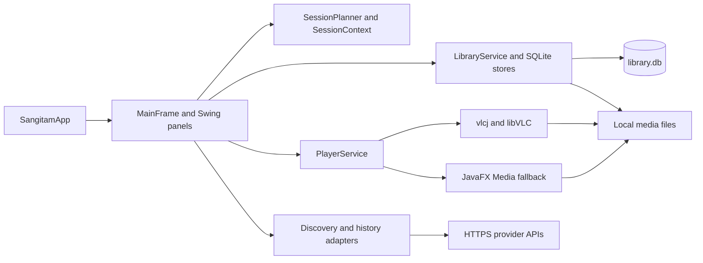
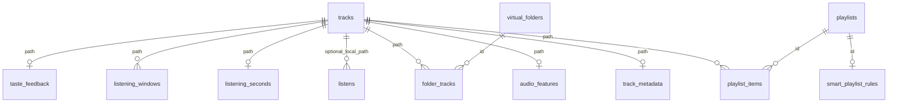

# Sangitam — Project and presentation guide

**Source snapshot** · 6 November 2026 · Java 21 · Maven project version `0.2.0-SNAPSHOT`

**Scope** · The working checkout, including in-progress source alongside commit `6335544`. The guide uses source inspection and the repository's recorded verification. It includes a schema map without reading your personal library or displaying credentials.

## Contents

- [Project structure and libraries](#1-project-structure-and-libraries)
- [Features and user flows](#2-features-and-user-flows)
- [Database and restart persistence](#3-database-and-restart-persistence)
- [Paging and large libraries](#4-paging-and-large-libraries)
- [Buttons, menus, keyboard, and drag and drop](#5-buttons-menus-keyboard-and-drag-and-drop)
- [Local audio analysis](#6-local-audio-analysis)
- [Mood and energy Journeys](#7-mood-and-energy-journeys)
- [Playback, VLC, JavaFX, EQ, and spectrum](#8-playback-vlc-javafx-eq-and-spectrum)
- [Internet connections](#9-internet-connections)
- [Distinctive features and future work](#10-distinctive-features-and-future-work)
- [Presentation plan, demo, and questions](#11-presentation-plan-demo-and-questions)
- [File-by-file reference](#12-file-by-file-reference)

## 1. Project structure and libraries

Sangitam is a Windows-first desktop player for a music collection you already own. It indexes files across drives, keeps metadata and organization in local storage, plays through VLC or JavaFX Media, and uses measurements from your own recordings to propose editable listening Journeys. Discover and Rediscover add optional internet features.

```text
MusicManagementApp/
  pom.xml, mvnw.cmd, mvnw      Build, dependencies, Maven wrapper
  build.bat, run.bat, run2.bat Windows development entry points
  Makefile                    Convenience targets for compile, run, test, clean
  package-windows.ps1         Experimental jpackage Windows app-image workflow
  src/sangitam/desktop/
    app/                      Entry point, startup timing and package probe
    ui/                       Swing screens, dialogs, actions and custom painting
    model/                    Tracks, credits, tags, playlists and settings values
    library/                  Import, tag extraction, catalog refresh and analysis
    storage/                  SQLite queries, user settings and credential access
    playback/                 Transport abstraction, engines and Windows controls
    session/                  Listening context and Journey selection
    discovery/                Online catalog and artist-profile adapters
    history/                  Qualified plays, elapsed listening and history sources
  native/                     C# Windows System Media Transport Controls companion
  tools/                      Fixture and launcher-icon generators
  test/                       JUnit tests and audio fixtures
  docs/                       Architecture, handoff and implementation walkthroughs
  bin/                        Generated application classes
```



`SangitamApp.main` schedules theme installation and `MainFrame` construction on Swing's Event Dispatch Thread (EDT). The first paint schedules workspace initialization. The frame coordinates actions, screen selection and queue state. `CardLayout` switches the central view and the side rail hosts the Library and Queue/History. Optional startup traces can record milestones such as the first catalog and Library page. Source inspection provides no startup-time guarantee. [Entry point](../src/sangitam/desktop/app/SangitamApp.java) · [MainFrame](../src/sangitam/desktop/ui/MainFrame.java) · [Architecture](ARCHITECTURE.md)

UI listeners and model publication run on the EDT. Import, paging, analysis and network work use `SwingWorker` or dedicated executors. Playback uses a VLC command worker or the JavaFX Application Thread, then publishes state to Swing. Immutable records and snapshots give readers a consistent view. Workers that can be superseded check request generations or worker identity before applying results.

| Dependency or platform API | Version in this checkout | Job |
| --- | --- | --- |
| JDK, Swing and AWT | Java 21 compile target | Desktop windows, listeners, key bindings, DnD, timers and custom drawing |
| OpenJFX `javafx-media` | 21.0.8 | Fallback decoder/player, EQ and live spectrum callbacks |
| vlcj and external libVLC | vlcj 4.12.1 | Java binding to the native VLC engine. VLC supplies its own decoder plugins |
| Xerial SQLite JDBC | 3.54.1.0 | Embedded SQLite through JDBC, plus custom functions/progress hooks where used |
| Jaudiotagger | 3.0.1 | Embedded labels, file headers and cover art |
| MP3SPI and Java Sound | MP3SPI 1.9.5.4 | Java Sound service provider for MP3 decoding and PCM input to the analyzer |
| Gson | 2.11.0 | Provider JSON and versioned local JSON records |
| JNativeHook | 2.2.2 | Global media-key fallback |
| Windows Credential Manager | Windows API via PowerShell helper code | Stores provider credentials under the signed-in user |
| JDK HTTP client, Java NIO and Preferences | JDK APIs | HTTPS requests, files and paths, small non-secret user preferences |
| JUnit Jupiter | 5.12.2 | Automated tests |
| C# helper and Windows APIs | Locally compiled | Optional Windows system media session and native transport events |

Run `build.bat` for a clean compile and an attempt to build the optional Windows helper, then `run.bat` to launch compiled code. The separate test command is `mvnw.cmd test`. The Windows packaging script stages a JAR and dependencies, generates an icon, attempts to include the media helper, and calls `jpackage --type app-image`. Release distribution and external VLC deployment still need validation. [Maven configuration](../pom.xml) · [Build script](../build.bat) · [Launcher](../run.bat) · [App-image script](../package-windows.ps1)

## 2. Features and user flows

| What you can show | What happens behind it |
| --- | --- |
| **Import files or folders** | The custom browser offers drive roots, an editable location, Up, and a file/folder listing. Import supports a recursive scan. The worker publishes progress and supports cancellation. |
| **General and Locations** | General browses songs, albums, artists, playlists and virtual folders with search, sorting and pins. Locations represents indexed paths on disk, including entries on disconnected drives. |
| **Home and collection pages** | Home shows up to 12 recently played tracks and eight pinned playlists. A collection page opens a full album, playlist or folder with Play and Queue. Embedded artwork is loaded asynchronously with version-aware bounded caching and fallbacks. |
| **Search local library** | Dedicated Songs, Albums and Artists tabs query the SQLite index. Filters include availability, literal text and sort order. |
| **Edit and restore details** | The editor covers basic labels, genre, classical fields, user tags, audio header details and measured traits. Group changes require explicit field choices. Selective restore releases chosen overrides and rereads the file. The app edits its index. |
| **Playlists and folders** | A regular playlist stores an ordered list of paths. Virtual folders group references and other folders. Song likes populate Liked Songs. Pins make important items easy to find. |
| **Smart playlists** | Save an AND rule over text, exact genre, required tags, energy/activity, minimum plays and availability. Preview shows counts and up to 20 examples. The limit is configurable up to 5,000. Membership refreshes after catalog changes. A fixed copy can be saved as a regular playlist. |
| **Playbar and queue** | Cover, linked title and credited artists, play/pause, stop, previous/next, shuffle, repeat-current, time controls, mute, volume, EQ and a queue/history dock. The active queue captures its order when started. |
| **Artist pages** | Credit-aware local songs, top tracks, albums, collaborators and listening totals. Manual notes/portrait can be used offline. Optional sourced profiles add a cached biography, image and attribution. |
| **Listen Now and Journey** | Choose an intent, mood, start/end energy and duration. Build and edit a temporary plan, review reasons, start playback or save it as a regular playlist. |
| **Rediscover** | Combines qualified local plays with optional provider-history imports for favorite groupings. Listening Insights separately shows measured local time by genre, classical period and estimated mood, and play events by source. |
| **Discover online** | Search one provider catalog and open a result in its own service. See [Internet connections](#9-internet-connections) for setup and boundaries. |
| **Settings, shortcuts and export** | Provider settings, audio settings, 16 configurable app commands, a quick-action palette, and M3U8 export of the current playlist or queue with local file references. |

[User-facing feature notes](../README.md) · [Smart playlists](SMART_PLAYLISTS.md) · [Home and metadata restoration](HOME_AND_METADATA_RESTORE.md) · [Playbar, artists and shortcuts](PLAYBAR_ARTISTS_AND_SHORTCUTS.md)

### Follow one recording from disk to library

1. `ImportMediaDialog` and `FileBrowserDialog` collect paths. `LibraryService` runs `LibraryScanner` on a worker. `Files.walkFileTree` handles recursive traversal and the scanner filters extensions.
2. The scanner normalizes local path identity, deduplicates within the scan, and checks file size and modification time to reuse unchanged metadata. Jaudiotagger reads supported embedded tags and technical headers. Filename fallback and narrowly scoped genre/classical text hints help when embedded fields are missing. Composer, conductor, soloist, performers, orchestra, work, movement, key, opus, period, form and instrumentation can be represented independently.
3. `LibraryStore` upserts file references and labels, preserves manually overridden fields, and records source folders. Rescanning can mark absent tracks unavailable. Removing an item from the catalog leaves its file on disk and can exclude it from reappearing through a normal rescan.
4. A catalog snapshot reaches Swing. Analysis can update it later. Playback opens the original file by path. A rename or drive change can break that reference, which is why reconnecting or importing the new location matters.

The scanner accepts `.mp3`, `.wav`, `.flac`, `.ogg`, `.oga`, `.aac`, `.m4a`, `.aif`, `.aiff` and `.wma`. That list controls which files enter the import flow. The actual codec determines what a playback or analysis backend can decode.

A classical **movement** identifies a part of a work, such as “II. Adagio.” The analysis screen's **movement/activity** score is the rate of noticeable audio changes. The library maintains these as separate fields. [Scanner](../src/sangitam/desktop/library/LibraryScanner.java) · [Library worker](../src/sangitam/desktop/library/LibraryService.java) · [Metadata walkthrough](IMPLEMENTATION_GUIDE.md)

## 3. Database and restart persistence

Sangitam uses **one embedded SQLite database**. On normal Windows installations it is `%APPDATA%\Sangitam\library.db`. Set `--data-dir <directory>` on the app or the Java property `sangitam.dataDir` to use a different database folder. macOS uses `~/Library/Application Support/Sangitam/`. The generic fallback uses `$XDG_DATA_HOME/Sangitam/` or `~/.local/share/Sangitam/`. Audio stays in its original files. [Path selection](../src/sangitam/desktop/storage/AppPaths.java)

### How the connection works

`MainFrame` constructs `LibraryStore(AppPaths.libraryDatabase())`. On first use the storage layer creates the directory, opens `DriverManager.getConnection("jdbc:sqlite:" + database)` and sets SQLite's `busy_timeout` to 5,000 ms. JDBC statements bind input values as parameters. Connections, statements and result sets normally close through try-with-resources. A number of write paths serialize on the shared store or use dedicated workers. Related operations, such as saving path and position together, use a transaction.

Initialization creates tables and indexes as needed. It checks existing columns with `PRAGMA table_info` and adds missing fields. The legacy playlist migration preserves IDs and membership positions. Title, play-count, recency and listening-time indexes support common queries. Several logical relationships are maintained by store operations and cleanup triggers. The diagram shows joins and ownership rather than declaring SQL foreign-key constraints. [LibraryStore](../src/sangitam/desktop/storage/LibraryStore.java) · [CollectionStore](../src/sangitam/desktop/storage/CollectionStore.java)



| Table | Key and representative contents |
| --- | --- |
| `tracks` | `path` · title, artist, album, duration, format, genre, basic energy/activity, versions and file stamps, overrides, availability, play count, added and last played times |
| `track_metadata` | `path` · versioned JSON payload for extended fields, provenance and tags, plus flattened search text |
| `audio_features` | `path` · versioned JSON with stamped signal estimates |
| `library_sources`, `library_exclusions` | Source/excluded `path` · remembered import scopes with recursive flags, and explicit exclusions |
| `playlists`, `playlist_items` | Playlist `id`, then `(playlist_id, position)` · collection metadata and ordered local track paths |
| `smart_playlist_rules` | `playlist_id` · versioned rule JSON. Result membership is evaluated against the catalog |
| `virtual_folders`, `folder_tracks` | Folder `id` with `parent_id`, then `(folder_id, path)` · nested virtual organization and track membership |
| `library_pins` | `(kind, item)` · typed identities for pins and song likes |
| `listens` | `(source, source_key)` · event identity, labels, timestamp, optional provider link and local path |
| `listening_seconds`, `listening_credits` | `path`, then `(path, name_key)` · accumulated local listening time and the credited artist keys |
| `listening_windows`, `taste_feedback` | Window `id` with path, time and seconds, plus one `rating` per path · inputs to Journey context |
| `artist_profiles`, `artist_enrichment`, `artist_aliases` | Normalized `name_key` or `alias` · manual bio/portrait, cached sourced text/image/attribution/date, alias-to-canonical mapping |
| `app_state` | `key` and text `value` · last track, position, volume, shortcut settings and artist lookup preference |

For a presentation, run these read-only statements in a SQLite viewer against a demo database or a copy of a closed app's database:

```sql
SELECT name FROM sqlite_schema
WHERE type = 'table' AND name NOT LIKE 'sqlite_%'
ORDER BY name;

PRAGMA table_info(tracks);

SELECT title, artist, format, duration_seconds, unavailable
FROM tracks ORDER BY title, path LIMIT 10;

SELECT key, value FROM app_state
WHERE key IN ('last_position', 'volume');
```

### Where the app remembers things

| State | Where and when |
| --- | --- |
| Last recording and position | SQLite `app_state.last_track` and `last_position`. A serial worker writes the two together. The frame saves after position changes of about five seconds during playback and when paused. Stop and natural end save zero for that track. |
| Startup resume | Once both catalog and memory are available, a matching track and its saved position appear in the playbar. Press Play to open it at that position. A user selection takes precedence and the saved path has to be usable. |
| Volume | SQLite `app_state.volume`. The slider uses a 250 ms debounced write and saves a touched value on close. A delayed load does not replace a volume the user already changed. |
| EQ and ReplayGain | `audio.properties` beside `library.db`. Save writes a temporary file and replaces the settings file, atomically where supported. |
| Keyboard shortcuts and online artist lookup | SQLite keys `shortcuts` and `artist_online`. |
| Last browsed folder and Apple storefront | Java user Preferences. These preferences are separate from the database folder override. |
| Provider secrets | Windows Credential Manager via `WindowsCredentialStore`. Development can supply process environment values. |

The restart behavior stores a recording and checkpoint. To keep an entire queue or Journey for later, save it as a playlist. [Playback memory worker](../src/sangitam/desktop/storage/PlaybackMemoryService.java) · [Frame restore and save logic](../src/sangitam/desktop/ui/MainFrame.java) · [Audio settings storage](../src/sangitam/desktop/storage/AudioSettingsStore.java)

## 4. Paging and large libraries

| Surface | Unit and data source | Algorithm |
| --- | --- | --- |
| **Search** | Up to 100 songs, album groups or artist groups per page from SQLite | Build filter and group clauses, count matching rows or groups and select the requested slice with `ORDER BY … LIMIT ? OFFSET ?`. Count and rows share a read transaction. Text input has a 180 ms debounce. |
| **Library → General** | Up to 100 entries per page from an in-memory mixed catalog snapshot | A worker builds and reuses one ordering per sort until the data changes, with pins first and stable ties. It scans that order for category, folder and literal text matches, counts them and keeps the requested page. Text input has a 160 ms debounce. Offset is clamped after removals. |
| **Library → Locations** | Up to 100 direct children per expanded branch | Build an in-memory index of imported paths, put folders before songs, and fetch branch slices on expansion. Previous/Next replace the nodes. Collapsing a branch releases descendants and keeps a placeholder. |
| **Home / smart previews** | Small shelves or bounded results | Home limits its shelves. A smart rule has a track limit and the preview presents a separate match count with up to 20 examples. |

Search escapes SQL wildcard characters so a typed percent or underscore is literal. The query can use flattened metadata text, with fallback for older entries. Alphabetical, recent and most-played orders include identity tie-breakers. When an input or tab changes, the UI resets the page. Old workers are cancelled and stale results are rejected. That second check handles a slow old request that finishes after a newer one.

A page limits what is displayed. An album can have 130 songs and still count as one General entry. Playback and queue actions get all its songs. General and Locations still keep the full catalog and their supporting in-memory structures. Search returns bounded rows, though a substring count and a deep offset may still require substantial work. The handoff's synthetic 100,000-track measurements cover specific queries and presentation work, with whole-app memory and interactive scale still open. [Search SQL](../src/sangitam/desktop/storage/LibrarySearchStore.java) · [Search UI](../src/sangitam/desktop/ui/SearchPanel.java) · [Library paging walkthrough](LIBRARY_PRESENTATION_PAGING.md)

## 5. Buttons, menus, keyboard, and drag and drop

| Interaction | Implementation |
| --- | --- |
| **Button or menu item** | Swing `addActionListener` invokes a callback. For example, `PlayerBar` calls its `Actions.playPause()`, wired by `MainFrame` to `togglePlayback()`. Playback state feeds back into the icon, tooltip, accessible name and enabled state. |
| **Double-click** | Mouse listeners check the actual cell or tree path. Songs start playback. Collection or artist rows open the matching view. In Locations, navigation rows can load another branch page instead. |
| **Right-click** | Listeners check `isPopupTrigger()` on both press and release for platform differences and target the row under the pointer. `LibraryMenus` builds a `JPopupMenu` with actions appropriate to the row kind. Many screens share the song menu. |
| **Drag and drop** | General uses Swing `TransferHandler`. It tracks the selected internal entry, provides a string-flavor transfer and validates the current target in `canImport`. `importData` routes accepted drops to `LibraryMenus.drop`. |
| **Keyboard** | Swing `InputMap`/`ActionMap`, menu accelerators and focused-list actions route to the same callbacks. Shortcut capture checks bindings and stores them. When plain Space is assigned to transport, a focus-aware dispatcher handles it ahead of ordinary control bindings and leaves editable text fields to handle typing. |
| **Seeking and volume** | The seek slider previews a position during a gesture and commits on release. The volume slider can update live. Coalesced commands apply the latest value without queueing every slider tick for the engine. |
| **Windows transport** | The optional C# SMTC helper receives player metadata and timeline through a local process protocol and sends back commands. JNativeHook handles global transport keys as a fallback and suppresses duplicate handling while native transport is active. Windows volume keys control system volume. |

Drag a song to a virtual folder to add a reference. Drag an album to a virtual folder to create a playlist there. Drag a playlist or folder to a virtual folder to move the library item. Dropping songs or collection members on a regular playlist adds their paths. Smart destinations own their rules and reject manual additions, including drops. The built-in Liked Songs list and artist rows have protected drag behavior. These operations update library organization in SQLite. [Drop policy](../src/sangitam/desktop/ui/LibraryPanel.java) · [Menu actions](../src/sangitam/desktop/ui/LibraryMenus.java) · [Windows companion](../native/MediaHost.cs)

## 6. Local audio analysis

The analyzer measures decoded sound on the device. It works independently of the player, so a file that VLC can play may remain **Not analyzed** if Java Sound cannot decode it.

1. **Decode and bound the work.** `AudioAnalyzer` uses Java Sound and MP3SPI to convert the input to 16-bit signed PCM. It reads up to 90 seconds, or up to 180 seconds for a recording whose known duration is at least 50 seconds. For that longer case the basic energy/activity pass uses the first eight seconds and the passage from 20 seconds onward. The richer feature pass uses a continuous decoded passage, mixed to mono with a reduced sample rate and a short-window amplitude envelope.
2. **Estimate energy and activity.** RMS, the root mean square of sample amplitudes, gives a level estimate. A 50 ms window measures RMS and short-term sample changes. The onset counter compares each window with the previous five and counts noticeable changes in level or texture. The activity score scales onsets per second to 0–100. The energy score is approximately `0.65 × scaled loudness + 0.35 × activity`, clamped to 0–100.
3. **Measure tempo, levels and dynamics.** Tempo compares repeating positive changes in the envelope across different time lags. Weak or short evidence leaves BPM unavailable. RMS and peak use dBFS, relative to digital full scale. The ratio of the 90th and 10th envelope percentiles estimates dynamics.
4. **Measure frequency content and key.** `SpectralFeatures` applies a Hann window and a 2,048-point FFT to overlapping mono frames. The energy-weighted average frequency is the spectral centroid, a rough brightness measure. Spectral peaks vote for 12 pitch classes. Correlation with major/minor templates proposes a key if the confidence clears a threshold.
5. **Derive mood traits.** Energy, activity and tempo contribute to arousal. Key mode and tempo contribute to valence. The code assigns a palette label such as Calm, Happy, Sad, Tense, Energetic or Balanced, with Unknown for very quiet input. It also computes a 12-point energy contour of the sampled passage.
6. **Cache with provenance.** The basic ratings and versioned rich payload are stored alongside file size and modification time. Freshness checks guard against stale analysis after a file changes. The background job can refresh old entries and Deep analyse library asks it to check for outstanding work. Manual energy/activity ratings remain separate from rich measurements.

Explain this as **digital signal processing plus heuristics**. A single bounded passage can miss a modulation, a quiet section or a major change later in an orchestral piece. Rubato can confuse tempo estimates. Instrumentation comes from tags or editable metadata. The estimates help rank recordings and carry uncertainty. [AudioAnalyzer](../src/sangitam/desktop/library/AudioAnalyzer.java) · [SpectralFeatures](../src/sangitam/desktop/library/SpectralFeatures.java) · [Analysis storage](../src/sangitam/desktop/storage/AudioFeatureStore.java)

## 7. Mood and energy Journeys

**Listen Now → Shape the session** captures Focus, Explore or Unwind, a mood palette, start and end energy, minutes, a familiarity preference and optional context. **Build my journey** flushes pending listening samples and loads context in the background. The frame filters missing/unavailable files. The planner excludes Avoid-rated tracks from automatic selection.

| Stage | How it works |
| --- | --- |
| **Start with listening context** | With Auto and context enabled, weight recent analyzed recordings from the last 90 minutes, stopping at a gap greater than 30 minutes. Weight recent and longer playback more. If that yields no usable signal, use up to 180 days of the device's history with similar local hours and calendar patterns. With no usable history, use a simple time-of-day energy default and neutral valence. |
| **Create a moving target** | At each step interpolate from start to end energy using estimated seconds already selected divided by requested seconds. For a 30-minute 70 → 30 arc, the target at 15 minutes is 50. |
| **Score the remaining tracks** | Prefer analyzed tracks near the current energy and intent's activity target. Score genre and instrumentation matches, familiarity or novelty, and diversity. Penalize repeated artists and distance from the target valence when rich features exist. |
| **Apply taste** | Five levels run from Avoid (−2) to Love (+2). Direct ratings carry most weight, with smaller effects through shared artist credits and genre. Likes and pins are independent. |
| **Fill approximately** | Pick the highest-scoring eligible unused track per slot. Use a three-minute duration estimate when missing, allow a bounded overrun for the next candidate, and stop once near 95% of target or out of eligible choices. If no candidate fits the very first slot, the shortest eligible track can be offered with a duration explanation. |
| **Explain and edit** | The energy plot lets you select a slot and inspect its reason. Replace with a similar-energy alternative, add, remove or reorder tracks. Play the draft or save it as a regular playlist. A new draft can coexist with active playback. |

In the source, explicit Happy targets valence 78, Sad and Tense target 25, and Calm, Energetic and Balanced share a neutral valence target. That makes the energy controls and intent important. The current planner uses greedy per-slot selection and a valence penalty. It gives a practical, explainable approximation of the requested arc. [SessionPlanner](../src/sangitam/desktop/session/SessionPlanner.java) · [SessionContext](../src/sangitam/desktop/session/SessionContext.java) · [Journey walkthrough](ARTIST_ENRICHMENT_AND_MOOD_SESSIONS.md)

### Play counts and minutes feed different features

A **qualified play** records a local history event once after half of the recording or four minutes of observed playback, whichever comes first. Seeking to the end does not manufacture that elapsed time. The separate `ListeningClock` accumulates time while playing, caps unusually large gaps between observations, and normally flushes every ten seconds. Its totals feed artist and Rediscover listening minutes, while recent timestamped windows feed Auto. Synced provider events add source counts, with local measured seconds kept as their own unit. [Qualified play tracker](../src/sangitam/desktop/history/QualifiedPlayTracker.java) · [Listening clock](../src/sangitam/desktop/history/ListeningClock.java) · [Insights store](../src/sangitam/desktop/storage/ListeningInsightsStore.java)

## 8. Playback, VLC, JavaFX, EQ, and spectrum

### From Play to sound

1. `MainFrame` chooses the current song or queue entry and lazily creates `VlcjPlayerService` behind `PlayerService`. The VLC adapter discovers a compatible native installation on its worker. If native initialization is unavailable, it uses `JavaFxPlayerService`. File-level decode errors in VLC have their own error path.
2. The selected engine checks the path, opens local audio and produces `PlaybackState` snapshots. Those carry the track, status, position, duration, error and seekability. Request IDs and current-player checks discard callbacks from an old track.
3. When playing, the Play button becomes Pause. When loading, repeat clicks cannot reopen the file. Pausing preserves the position. A seek uses the decoder's actual duration and capability, and the next state snapshot reconciles the displayed time.
4. On end, the frame repeats the current song if enabled, otherwise advances the active queue or the available library order. Shuffle chooses a different available song or an unplayed queue slot. Stop resets the saved position.

The original stuck Play button and disabled playhead shared a state bug. A late VLC ready callback could replace Playing with Loading. The VLC adapter now samples native state on its command thread, and seeking is enabled by decoder state. This is a concrete example of why events and state transitions matter. [VLC adapter](../src/sangitam/desktop/playback/VlcjPlayerService.java) · [JavaFX adapter](../src/sangitam/desktop/playback/JavaFxPlayerService.java) · [Defect history](PROJECT_HANDOFF.md)

### What VLC supports that JavaFX Media does not

“VLS” refers to **VLC** here. **VLC** is the player ecosystem, **libVLC** is its native playback engine, and **vlcj** is the Java binding Sangitam calls. The scanner's extension check, the playback decoder and the analysis decoder are three separate checks.

| | VLC path | JavaFX fallback |
| --- | --- | --- |
| **Media support** | A modular demux/codec ecosystem with broader coverage, including FLAC, Ogg Vorbis, WMA in ASF, and ALAC. The installed build and its plugins determine actual support. | OpenJFX 21 documents MP3, AAC in MP4/M4A and uncompressed PCM in WAV/AIFF among its audio combinations. Its documented table omits FLAC, Ogg Vorbis, WMA and ALAC. An M4A containing ALAC can therefore differ from an M4A containing AAC. |
| **App capabilities** | Native EQ, 150% volume ceiling and tag-driven Track/Album ReplayGain. | Same app EQ layout, 100% volume ceiling and a live spectrum callback. |
| **Reason for the difference** | libVLC can load a broad set of native container readers and codec plugins. | JavaFX Media exposes a narrower set of supported container and codec combinations. A file extension alone does not identify the codec inside it. |

The repository records local WAV and MP3 playback checks for both engines. Present broader codec coverage as an engine capability. The checkout has no verified per-format Windows support matrix. [OpenJFX 21 media formats](https://openjfx.io/javadoc/21/javafx.media/javafx/scene/media/package-summary.html) · [VideoLAN libVLC](https://images.videolan.org/vlc/libvlc.html) · [VideoLAN format and codec list](https://images.videolan.org/vlc/features.html)

### EQ, preamp, volume, ReplayGain and spectrum

| Control or signal | Meaning and implementation |
| --- | --- |
| **Ten-band EQ** | Changes gain around 31.25, 62.5, 125, 250, 500, 1,000, 2,000, 4,000, 8,000 and 16,000 Hz. Each band can cut or boost from −12 to +12 dB. The app uses a shared settings model and applies the gains to either decoder. |
| **Preamp** | Overall EQ level from −12 to 0 dB. A cut creates headroom when bands are boosted. Flat EQ with UI preamp at 0 dB aims for unity. The VLC 3 single-pass EQ has a dry-signal factor of 0.25, so the adapter adds an internal `20 log10(4)` offset. |
| **Master volume** | Changes the overall output. Native VLC gets the requested percentage. The JavaFX adapter maps the app slider through a cubic gain curve and respects the backend's 100% ceiling. |
| **ReplayGain** | VLC reads existing Track or Album gain tags with peak protection and zero default gain. A saved mode takes effect at the next track start so playback can continue. JavaFX reports this feature unavailable. |
| **Live spectrum** | A readout of frequency magnitudes from the current JavaFX decoder. It requests 32 bands at about 100 ms intervals with a −72 dB threshold. The Swing panel draws real bars, clears on pause and displays an unsupported message in native VLC mode. |
| **Offline FFT / Journey graph** | The analyzer's FFT describes a sampled passage and helps estimate brightness and key. The Journey graph plots energy of selected tracks in order. Both serve different purposes from the real-time spectrum. |

The playbar's mini EQ shows the saved curve. The settings panel routes draft changes through the live preview. The dialog can save the new values or restore the prior values when cancelled. [AudioSettings](../src/sangitam/desktop/playback/AudioSettings.java) · [Gain mapping](../src/sangitam/desktop/playback/AudioGain.java) · [Spectrum panel](../src/sangitam/desktop/ui/SpectrumPanel.java) · [OpenJFX MediaPlayer API](https://openjfx.io/javadoc/21/javafx.media/javafx/scene/media/MediaPlayer.html)

## 9. Internet connections

| Feature | Endpoint family and data | What Sangitam uses |
| --- | --- | --- |
| **Spotify catalog** | Spotify Web API track search | Bearer access token supplied through Settings or environment. Returns track metadata and an official link. |
| **YouTube catalog** | YouTube Data API search scoped to music videos | API key. Returns video titles/channel metadata and watch links. |
| **Apple Music catalog** | Apple Music API catalog search for a storefront | Developer token and storefront. Returns catalog song metadata and official links. |
| **MusicBrainz catalog** | Public MusicBrainz recording search | Public recording metadata and links. This adapter serves Discover. |
| **Spotify, Last.fm, ListenBrainz history** | Bounded recent-play requests | Spotify account access with recently played scope, Last.fm username and key, or ListenBrainz public username. Imports source-specific events into `listens`. |
| **Artist enrichment** | English Wikipedia queries and eligible Wikimedia Commons thumbnails | Sends public artist names for matching and uses role evidence to choose a plausible music result. Stores excerpt, eligible portrait and attribution locally. |

Catalog adapters implement `MusicProvider` and return `CatalogTrack` values. The panel invokes a background worker. `CatalogHttp` uses Java's `HttpClient`, URL encoding, an eight-second connection timeout, a 12-second request timeout and Gson parsing. It maps 401/403 to access denied and 429 to rate limiting. History has a parallel adapter interface and HTTP helper. Where required, Settings retrieves credentials from Windows Credential Manager, with an environment fallback. The app expects externally supplied credentials and exposes errors for failures such as expired tokens or unavailable services.

Artist profiles can look up a public credit when opened. The current preference defaults to enabled when unset, can be disabled via **Online profile**, and can be overridden for a launch with `--offline-profiles`. Refresh/match can use a fuller name. Cached biographies and eligible portraits can be shown offline. The store can transactionally normalize resolved aliases across indexed credits, search text, pins and listening credits. Manual profiles have precedence.

Local playback uses `Track` paths. Discover results use `CatalogTrack` links and open the provider through `Desktop.browse`. Local scanning, analysis, taste and Journey building use local data. In-app provider sign-in, generic provider streaming, and provider playlist mirroring remain future scope. [Provider adapters](../src/sangitam/desktop/discovery) · [History adapters](../src/sangitam/desktop/history) · [Credentials](../src/sangitam/desktop/storage/ProviderCredentials.java) · [Artist enrichment](ARTIST_ENRICHMENT_AND_MOOD_SESSIONS.md)

## 10. Distinctive features and future work

| Strong presentation point | Why it matters |
| --- | --- |
| **Explainable, editable listening arc** | You choose where the listening session should start and end. The app uses the actual local recordings, shows reasons and allows slot-by-slot changes. |
| **Classical-aware metadata** | Composer, conductor, orchestra, soloist, work and movement survive independently. Field provenance, protected edits and selective restoration make an imperfect tag library usable. |
| **Local analysis alongside manual preferences** | Signal estimates can guide selection even with sparse tags. Explicit ratings, corrections and taste remain under the listener's control. |
| **Two useful measures of listening** | Qualified play count recognizes a meaningful play. Elapsed listening time shows how long audio played. A long symphony and a short song can each count as one play and contribute very different minutes. |
| **Local ownership with optional discovery** | The user's files and library work offline, while provider links and sourced artist profiles extend discovery. |
| **Scale-aware presentation and two playback backends** | Bounded result pages, background work and a decoder fallback address everyday usability on large collections and different Windows setups. |

These are distinguishing aspects of the implementation. Several build on familiar music-player ideas.

| Priority | Possible improvement | What to demonstrate or measure |
| --- | --- | --- |
| **1. Reliable everyday playback** | Test a codec matrix, fast seeks, removable/network drives, Windows media flyout and output-device changes. Add a headroom/clip indicator, real VLC spectrum, then gapless or crossfade. | Actual audio, seek accuracy and transition time across formats and engines. |
| **2. Scale the full catalog** | Move General and Locations summaries into indexed queries, defer full membership until needed, consider full-text or keyset paging where appropriate, and support relinking moved files. | Time to first usable page, peak RAM and navigation latency on real libraries. |
| **3. Build work-aware classical Journeys** | Analyze several passages and improve confidence estimates. Keep multi-movement works together, choose preferred performances, and optimize transitions for duration, tempo and intensity. | Compare generated sessions using diverse music and show reasons for grouping. |
| **4. Extend listening insights** | Add date filters, trends and exports. Offer private comparisons of composers, performances, ensembles and work versions. | Defined denominators, time windows and useful charts on a demo dataset. |
| **5. Extend discovery and ship a release** | Add official sign-in/refresh and source-aware links where provider APIs permit. Verify the app-image, dependency licenses, upgrade/backup and a signed Windows distribution. | Fresh-machine setup, repeatable releases and explicit provider capabilities. |

Density presets, full-screen, undo/redo and several Help or export entries are disabled placeholders. Gapless, crossfade, full-track analysis, automatic instrument recognition and a production Windows installer are still open. Actual Windows media flyout behavior and broader audio-format coverage need interactive verification. [Menu source](../src/sangitam/desktop/ui/AppMenuBar.java) · [Roadmap and verification history](PROJECT_HANDOFF.md)

## 11. Presentation plan, demo, and questions

### An eight-slide talk

| Slide | Say and show |
| --- | --- |
| **1. Problem and product** | “My local recordings were spread across drives, and classical tracks needed more than a title and artist. Sangitam indexes that library, plays it and builds listening sessions from it.” Show the Home screen. |
| **2. Architecture** | Show Swing → services → files/SQLite/decoder. Explain why heavy work uses workers and why local media and online catalog results have different types. |
| **3. Import and SQLite** | Import a small folder, show one row and explain path identity, file stamps, rescans, overrides and why the database stays small compared with the collection. |
| **4. Library at scale** | Compare SQL Search, in-memory General paging, and lazy Locations. Right-click a song and put it in a playlist. Contrast regular membership with a saved smart rule. |
| **5. Playback** | Play, pause and seek. Explain engine discovery, the state feedback loop, volume persistence and EQ. Show spectrum only when running the JavaFX fallback. |
| **6. Audio measurements and Journey** | Show Edit details → Analysis, then build a Journey. Point at the graph, explain an individual choice, replace a slot and save the draft. |
| **7. Online and Rediscover** | Show an external catalog link or cached sourced artist profile. Explain what travels over HTTPS and how local minutes differ from provider event counts. |
| **8. Results and next steps** | Show the recorded scope of tests, the known runtime limits and two concrete improvements you would prioritize. |

### Demo sequence and verification

Prepare a demo catalog with a small selection of MP3 and PCM WAV files, an album with usable tags, and at least one existing qualified play if you want a populated recent shelf. A separate data directory lets you demonstrate SQLite with paths you are comfortable showing. The Maven launcher accepts application arguments, for example:

```powershell
.\build.bat
.\mvnw.cmd -q exec:java '-Dexec.args=--data-dir sangitam-demo-data --offline-profiles'
```

1. Import a folder or switch drive roots in the chooser. Show the same recording in Locations and Search.
2. Edit one classical field or tag. Create a regular playlist, drag a track into it, then preview a smart rule that matches your tag.
3. Start playback, pause, move the playhead and resume. Adjust volume and EQ. Close and reopen the same demo data directory if you want to show the saved track and volume.
4. Show analysis for a supported recording. Build an Unwind Journey with an obvious descending energy arc. Explain one reason, change a slot, and save it.
5. Open Rediscover to contrast local time with counts. For an internet demo, MusicBrainz catalog search can be tried without provider credentials, subject to a live connection.

The project handoff records a clean build and 121 tests in its latest Journey/artist milestone, with 115 passing and six opt-in checks skipped. It separately records focused Windows WAV/MP3 transport checks from the earlier playback investigation and a headless public Beethoven profile lookup. These are historical results. No build, test suite, app launch or personal database inspection was performed for this documentation change. [Recorded checks](PROJECT_HANDOFF.md)

### Questions you may be asked

| Question | Short answer |
| --- | --- |
| **Why SQLite?** | The data belongs to one desktop user. SQLite offers transactions, joins and indexes in an embedded file with no database server to run. |
| **What happens if a drive is unplugged?** | Indexed paths can stay visible as unavailable. The app can skip them in playback or selection, and a rescan can see them again after reconnection. |
| **Does the app store a duplicate of my song?** | It stores the path, tags, measurements and history. The decoder opens the original audio file. |
| **Why use Swing plus JavaFX?** | Swing owns the desktop UI and interaction. JavaFX Media is an audio backend behind the same transport interface as VLC. |
| **How do you keep Swing responsive?** | Send expensive work to workers and return small results to the EDT. Cancel superseded requests and check their identity before applying them. |
| **Why does a file play but have no mood?** | Playback can use VLC's decoders. The analyzer needs PCM through Java Sound and its installed service providers. Those have different support. |
| **How does it infer mood?** | It estimates musical traits from sample levels, spectral content, tempo and key. The planner uses those estimates plus editable preferences and listening context. |
| **What makes a Journey different from shuffle?** | It scores candidates against a changing target, a time budget, mood, taste and variety. It also shows the selected order and reasons for editing. |
| **What is the difference between EQ and spectrum?** | EQ changes gain by frequency range. A spectrum measures how strong frequency ranges are in the audio currently playing. |
| **What is saved when I close it?** | A local track and position checkpoint, app volume, audio preferences and library state. A saved playlist preserves the Journey's order. |
| **Is Discover a streaming service?** | It fetches provider metadata and opens the official link. Local music playback is a separate flow. |
| **How do you test it?** | Use generated audio and isolated SQLite data for repeatable checks, headless Swing tests for callbacks and paging, and interactive Windows tests for real playback, drive navigation and system integration. |

## 12. File-by-file reference

All production Java files under `src/sangitam/desktop` are listed below. The library column names the main JDK and external API families used by each file, based on source imports and key runtime dependencies. **JDK core** covers ordinary language, collections and utility types. Most files also use Sangitam's own classes. The analyzer reaches MP3SPI through Java Sound and the JDBC stores reach the Xerial driver through the shared connection.

### `app`

| File | Main libraries and APIs | Role |
| --- | --- | --- |
| [PackageCheck.java](../src/sangitam/desktop/app/PackageCheck.java) | JDBC, NIO, OpenJFX and vlcj class loading | Checks packaged Java dependencies and opens a temporary in-memory SQLite connection. |
| [SangitamApp.java](../src/sangitam/desktop/app/SangitamApp.java) | Swing, NIO | Parses launch flags and constructs the Swing application on the EDT. |
| [StartupTrace.java](../src/sangitam/desktop/app/StartupTrace.java) | NIO, I/O, JDK concurrency | Collects optional startup milestone timings and writes a report. |

### `discovery`

| File | Main libraries and APIs | Role |
| --- | --- | --- |
| [AppleMusicProvider.java](../src/sangitam/desktop/discovery/AppleMusicProvider.java) | Gson, JDK networking | Searches a selected Apple storefront and maps songs to catalog links. |
| [ArtistEnrichmentClient.java](../src/sangitam/desktop/discovery/ArtistEnrichmentClient.java) | AWT, ImageIO, Gson, JDK HTTP, JDK networking, NIO, I/O, Time API | Matches Wikipedia musician profiles and fetches attributed Commons portraits. |
| [CatalogHttp.java](../src/sangitam/desktop/discovery/CatalogHttp.java) | Gson, JDK HTTP, JDK networking, NIO, I/O, Time API | Encodes catalog queries, makes bounded requests and parses JSON. |
| [CatalogTrack.java](../src/sangitam/desktop/discovery/CatalogTrack.java) | JDK networking | Carries provider labels, duration and a link for a discovered result. |
| [MusicBrainzProvider.java](../src/sangitam/desktop/discovery/MusicBrainzProvider.java) | Gson, JDK networking | Searches public MusicBrainz recordings. |
| [MusicProvider.java](../src/sangitam/desktop/discovery/MusicProvider.java) | JDK core | Defines provider identity and the catalog search interface. |
| [SpotifyProvider.java](../src/sangitam/desktop/discovery/SpotifyProvider.java) | Gson, JDK networking | Searches Spotify track metadata with a bearer token. |
| [YouTubeProvider.java](../src/sangitam/desktop/discovery/YouTubeProvider.java) | Gson, JDK networking | Searches music videos and builds watch links. |

### `history`

| File | Main libraries and APIs | Role |
| --- | --- | --- |
| [Favorite.java](../src/sangitam/desktop/history/Favorite.java) | JDK networking, NIO | Represents a grouped favorite and its listening evidence. |
| [FavoritesAnalyzer.java](../src/sangitam/desktop/history/FavoritesAnalyzer.java) | NIO, Time API, Text API | Groups normalized song/artist history for rankings. |
| [HistoryHttp.java](../src/sangitam/desktop/history/HistoryHttp.java) | Gson, JDK HTTP, JDK networking, NIO, I/O, Time API | Makes timed history API requests and parses JSON. |
| [HistoryService.java](../src/sangitam/desktop/history/HistoryService.java) | Swing, JDK concurrency | Fetches/imports history on workers and reloads saved summaries. |
| [HistorySource.java](../src/sangitam/desktop/history/HistorySource.java) | JDK core | Defines the recent-history source interface. |
| [LastFmHistorySource.java](../src/sangitam/desktop/history/LastFmHistorySource.java) | Gson, JDK networking | Reads a user's recent Last.fm tracks. |
| [ListenBrainzHistorySource.java](../src/sangitam/desktop/history/ListenBrainzHistorySource.java) | Gson, JDK networking | Reads a public ListenBrainz user's listens. |
| [ListenEvent.java](../src/sangitam/desktop/history/ListenEvent.java) | JDK networking, NIO | Represents one source-identified listen with an optional local path or provider link. |
| [ListeningClock.java](../src/sangitam/desktop/history/ListeningClock.java) | NIO | Accumulates elapsed local playback time per path. |
| [QualifiedPlayTracker.java](../src/sangitam/desktop/history/QualifiedPlayTracker.java) | JDK core | Emits at most one qualified-play signal per playback generation. |
| [SpotifyHistorySource.java](../src/sangitam/desktop/history/SpotifyHistorySource.java) | Gson, JDK networking, Time API | Reads a Spotify account's recently played tracks. |

### `library`

| File | Main libraries and APIs | Role |
| --- | --- | --- |
| [AudioAnalyzer.java](../src/sangitam/desktop/library/AudioAnalyzer.java) | Java Sound, NIO, MP3SPI via Java Sound | Decodes local PCM and computes windowed RMS, onsets and basic scores. |
| [ClassicalHints.java](../src/sangitam/desktop/library/ClassicalHints.java) | NIO | Extracts conservative classical fields from explicit text cues. |
| [GenreHints.java](../src/sangitam/desktop/library/GenreHints.java) | NIO | Provides fallback genre evidence from recognizable folder names. |
| [LibraryScanner.java](../src/sangitam/desktop/library/LibraryScanner.java) | Jaudiotagger, NIO, I/O | Walks sources, deduplicates paths and reads embedded tags and file headers. |
| [LibraryService.java](../src/sangitam/desktop/library/LibraryService.java) | Swing, NIO, JDK concurrency | Runs import, rescan, edits and analysis, then publishes catalog snapshots. |
| [SpectralFeatures.java](../src/sangitam/desktop/library/SpectralFeatures.java) | JDK core | Implements FFT, chroma, tempo, key, dynamics and mood estimates in Java. |
| [TagVocabulary.java](../src/sangitam/desktop/library/TagVocabulary.java) | JDK core | Defines optional tag suggestions for editing. |
| [TrackSearch.java](../src/sangitam/desktop/library/TrackSearch.java) | JDK core | Provides in-memory track matching and display-label helpers, separate from SQL Search. |

### `model`

| File | Main libraries and APIs | Role |
| --- | --- | --- |
| [ArtistCredits.java](../src/sangitam/desktop/model/ArtistCredits.java) | JDK core | Normalizes and groups named performer and classical credits. |
| [AudioFeatures.java](../src/sangitam/desktop/model/AudioFeatures.java) | JDK core | Holds versioned measured traits and the sampled energy contour. |
| [DetailReset.java](../src/sangitam/desktop/model/DetailReset.java) | JDK core | Describes which manual overrides a restoration should release. |
| [FileStamp.java](../src/sangitam/desktop/model/FileStamp.java) | JDK core | Represents file size and modification time for freshness checks. |
| [LibraryCollections.java](../src/sangitam/desktop/model/LibraryCollections.java) | NIO | Carries virtual folders, playlists, typed entry identities and pins. |
| [LibrarySource.java](../src/sangitam/desktop/model/LibrarySource.java) | NIO | Represents an imported path and its recursive scan option. |
| [PlaybackMemory.java](../src/sangitam/desktop/model/PlaybackMemory.java) | NIO | Carries the last local path and position. |
| [Playlist.java](../src/sangitam/desktop/model/Playlist.java) | NIO | Represents a named collection with resolved ordered paths and an optional smart rule. |
| [ShortcutBindings.java](../src/sangitam/desktop/model/ShortcutBindings.java) | Swing, AWT | Defines configurable command IDs, default keystrokes and validation. |
| [SmartPlaylistRule.java](../src/sangitam/desktop/model/SmartPlaylistRule.java) | JDK core | Validates normalized conditions, ranges, ordering and track limit. |
| [Track.java](../src/sangitam/desktop/model/Track.java) | NIO | Represents a local recording and its path-based identity. |
| [TrackMetadata.java](../src/sangitam/desktop/model/TrackMetadata.java) | JDK core | Models extended fields, origins, overrides, tags and technical details. |
| [TrackTags.java](../src/sangitam/desktop/model/TrackTags.java) | JDK core | Holds editable energy/activity, freshness and richer audio features. |

### `playback`

| File | Main libraries and APIs | Role |
| --- | --- | --- |
| [AudioGain.java](../src/sangitam/desktop/playback/AudioGain.java) | JDK core | Maps slider percentages, cubic gain and VLC EQ compensation. |
| [AudioSettings.java](../src/sangitam/desktop/playback/AudioSettings.java) | JDK core | Validates ten band gains, preamp and ReplayGain preferences. |
| [AudioStatus.java](../src/sangitam/desktop/playback/AudioStatus.java) | JDK core | Reports backend, active normalization mode and an optional capability error. |
| [CoalescedCommand.java](../src/sangitam/desktop/playback/CoalescedCommand.java) | JDK concurrency | Runs the latest requested value without scheduling every intermediate update. |
| [GlobalMediaKeys.java](../src/sangitam/desktop/playback/GlobalMediaKeys.java) | Swing, JNativeHook | Routes global media keys back to Swing and suppresses duplicate transport. |
| [JavaFxPlayerService.java](../src/sangitam/desktop/playback/JavaFxPlayerService.java) | Swing, OpenJFX, NIO, JDK concurrency | Implements fallback playback, seeking, equalizer and spectrum. |
| [PlaybackState.java](../src/sangitam/desktop/playback/PlaybackState.java) | JDK core | Publishes a transport snapshot for the UI and observers. |
| [PlayerService.java](../src/sangitam/desktop/playback/PlayerService.java) | JDK core | Defines the UI-facing playback and audio control contract. |
| [VlcjPlayerService.java](../src/sangitam/desktop/playback/VlcjPlayerService.java) | Swing, vlcj, NIO, JDK concurrency | Discovers and drives native VLC, with JavaFX fallback. |
| [WindowsMediaBridge.java](../src/sangitam/desktop/playback/WindowsMediaBridge.java) | Swing, NIO, I/O, JDK concurrency, Windows SMTC via C# helper | Starts the optional helper and exchanges local transport messages. |

### `session`

| File | Main libraries and APIs | Role |
| --- | --- | --- |
| [SessionContext.java](../src/sangitam/desktop/session/SessionContext.java) | NIO, Time API | Weights recent and calendar-similar listening and computes taste affinities. |
| [SessionPlanner.java](../src/sangitam/desktop/session/SessionPlanner.java) | NIO | Scores candidates along an energy arc and returns a timed, explained plan. |

### `storage`

| File | Main libraries and APIs | Role |
| --- | --- | --- |
| [AppPaths.java](../src/sangitam/desktop/storage/AppPaths.java) | NIO | Selects the database path for the OS or launch override. |
| [AppPreferences.java](../src/sangitam/desktop/storage/AppPreferences.java) | NIO, Preferences | Stores last browser directory and storefront in Java user preferences. |
| [ArtistEnrichmentStore.java](../src/sangitam/desktop/storage/ArtistEnrichmentStore.java) | JDBC, NIO | Caches sourced profiles and transactionally merges artist aliases. |
| [ArtistStore.java](../src/sangitam/desktop/storage/ArtistStore.java) | JDBC, NIO | Persists manual profiles, elapsed seconds and artist-credit mappings. |
| [AudioFeatureStore.java](../src/sangitam/desktop/storage/AudioFeatureStore.java) | JDBC, Gson, NIO | Stores and checks versioned rich analysis payloads. |
| [AudioSettingsStore.java](../src/sangitam/desktop/storage/AudioSettingsStore.java) | NIO, I/O | Reads and safely replaces the audio settings properties file. |
| [CollectionStore.java](../src/sangitam/desktop/storage/CollectionStore.java) | JDBC, NIO | Manages virtual folders, playlists, membership, pins and collection migrations. |
| [LibraryDashboardStore.java](../src/sangitam/desktop/storage/LibraryDashboardStore.java) | JDBC, NIO | Queries recent available tracks for the Home shelf. |
| [LibrarySearchStore.java](../src/sangitam/desktop/storage/LibrarySearchStore.java) | JDBC, NIO, SQLite JDBC | Builds grouped, filtered, counted and ordered SQLite pages. |
| [LibraryStore.java](../src/sangitam/desktop/storage/LibraryStore.java) | JDBC, JDK networking, NIO, SQLite JDBC | Owns the JDBC connection, schema, catalog, listens and playback memory. |
| [ListeningInsightsStore.java](../src/sangitam/desktop/storage/ListeningInsightsStore.java) | JDBC, JDK concurrency | Aggregates local seconds by current metadata and event counts by source. |
| [MetadataStore.java](../src/sangitam/desktop/storage/MetadataStore.java) | JDBC, Gson, NIO | Encodes versioned details and prepares searchable text. |
| [PlaybackMemoryService.java](../src/sangitam/desktop/storage/PlaybackMemoryService.java) | Swing, JDK concurrency | Serializes memory, volume and measured-listening writes off the EDT. |
| [ProviderCredentials.java](../src/sangitam/desktop/storage/ProviderCredentials.java) | JDK concurrency | Resolves configured credentials and development environment fallback. |
| [ShortcutStore.java](../src/sangitam/desktop/storage/ShortcutStore.java) | JDBC, Gson | Loads and saves a versioned binding map in app state. |
| [SmartPlaylistStore.java](../src/sangitam/desktop/storage/SmartPlaylistStore.java) | SQLite JDBC, JDBC, Gson, NIO | Persists, previews and resolves smart rules using bounded SQL. |
| [TasteStore.java](../src/sangitam/desktop/storage/TasteStore.java) | JDBC, NIO, Time API | Stores preference ratings and timestamped playback windows. |
| [WindowsCredentialStore.java](../src/sangitam/desktop/storage/WindowsCredentialStore.java) | NIO, I/O, JDK concurrency, PowerShell, Win32 API | Uses a PowerShell child process and Win32 Credential Manager interop. |

### `ui`

| File | Main libraries and APIs | Role |
| --- | --- | --- |
| [AppIcons.java](../src/sangitam/desktop/ui/AppIcons.java) | Swing, AWT | Draws app and control glyphs. |
| [AppMenuBar.java](../src/sangitam/desktop/ui/AppMenuBar.java) | Swing, AWT | Builds menus, checked actions, accelerators and disabled placeholders. |
| [ArtistPageData.java](../src/sangitam/desktop/ui/ArtistPageData.java) | NIO | Builds local credited songs, rankings, albums and collaborator summaries. |
| [ArtistPanel.java](../src/sangitam/desktop/ui/ArtistPanel.java) | Swing, AWT, ImageIO, NIO, I/O | Renders an artist page and manages asynchronous profile editing/enrichment. |
| [AudioSettingsDialog.java](../src/sangitam/desktop/ui/AudioSettingsDialog.java) | Swing, AWT | Opens the audio settings panel and coordinates preview/save/cancel. |
| [AudioSettingsPanel.java](../src/sangitam/desktop/ui/AudioSettingsPanel.java) | Swing, AWT, JDK concurrency | Displays EQ bands, preamp and backend/ReplayGain status. |
| [CommandPaletteDialog.java](../src/sangitam/desktop/ui/CommandPaletteDialog.java) | Swing, AWT | Offers searchable quick actions. |
| [DashboardPanel.java](../src/sangitam/desktop/ui/DashboardPanel.java) | Swing, AWT | Assembles Home shelves, the Journey composer and the editable session view. |
| [DetailResetPanel.java](../src/sangitam/desktop/ui/DetailResetPanel.java) | Swing, AWT | Collects selected groups of file details to restore. |
| [DiscoverPanel.java](../src/sangitam/desktop/ui/DiscoverPanel.java) | Swing, AWT, I/O | Runs catalog searches and opens official provider links. |
| [FileBrowserDialog.java](../src/sangitam/desktop/ui/FileBrowserDialog.java) | Swing, AWT, NIO, I/O | Browses available drives and filesystem paths asynchronously. |
| [FlatInputUI.java](../src/sangitam/desktop/ui/FlatInputUI.java) | Swing, AWT | Supplies the shared dark combo-box and spinner appearance. |
| [GeneralLibraryPages.java](../src/sangitam/desktop/ui/GeneralLibraryPages.java) | NIO, JDK concurrency | Caches orderings and filters and slices mixed entries for General. |
| [HomeLibraryData.java](../src/sangitam/desktop/ui/HomeLibraryData.java) | NIO | Holds bounded recent and pinned shelf entries and artwork state. |
| [HomeLibraryPanel.java](../src/sangitam/desktop/ui/HomeLibraryPanel.java) | Swing, AWT | Draws the Home shelves and routes their actions. |
| [ImportMediaDialog.java](../src/sangitam/desktop/ui/ImportMediaDialog.java) | Swing, AWT, NIO | Collects import paths, options, progress and cancellation. |
| [LibraryArtwork.java](../src/sangitam/desktop/ui/LibraryArtwork.java) | Swing, AWT, ImageIO, Jaudiotagger, NIO, I/O, JDK concurrency | Reads and caches file-stamped embedded artwork off the EDT. |
| [LibraryDetailPanel.java](../src/sangitam/desktop/ui/LibraryDetailPanel.java) | Swing, AWT | Shows full collection contents and play/queue actions. |
| [LibraryEntry.java](../src/sangitam/desktop/ui/LibraryEntry.java) | NIO | Builds and represents typed song, album, artist, playlist and folder entries. |
| [LibraryFolderTree.java](../src/sangitam/desktop/ui/LibraryFolderTree.java) | Swing, AWT, NIO | Loads indexed branch pages and manages lazy Swing nodes. |
| [LibraryHover.java](../src/sangitam/desktop/ui/LibraryHover.java) | JDK core | Provides lightweight hover feedback for library list/tree rows. |
| [LibraryMenus.java](../src/sangitam/desktop/ui/LibraryMenus.java) | Swing, AWT, NIO | Builds context menus and dispatches collection and drop operations. |
| [LibraryPanel.java](../src/sangitam/desktop/ui/LibraryPanel.java) | Swing, AWT DnD, AWT, NIO | Owns the library rail, General paging, filters, navigation and TransferHandler. |
| [ListeningInsightsPanel.java](../src/sangitam/desktop/ui/ListeningInsightsPanel.java) | Swing, AWT | Loads and displays local-minute and source-count summaries. |
| [LiveAudioPreview.java](../src/sangitam/desktop/ui/LiveAudioPreview.java) | Swing | Tracks draft audio settings for live application and cancellation. |
| [LocationIndex.java](../src/sangitam/desktop/ui/LocationIndex.java) | NIO, JDK concurrency | Builds an in-memory hierarchy and returns direct-child path pages. |
| [MainFrame.java](../src/sangitam/desktop/ui/MainFrame.java) | Swing, AWT, NIO, JDK concurrency | Wires services, screens, queue, shortcuts, settings and transport. |
| [MarqueeButton.java](../src/sangitam/desktop/ui/MarqueeButton.java) | Swing, AWT | Scrolls overflowing button text in the playbar. |
| [NavigationPanel.java](../src/sangitam/desktop/ui/NavigationPanel.java) | Swing, AWT | Builds the main navigation buttons and selected state. |
| [NotificationCenter.java](../src/sangitam/desktop/ui/NotificationCenter.java) | Swing, AWT | Presents short status and error notifications. |
| [PlayerBar.java](../src/sangitam/desktop/ui/PlayerBar.java) | Swing, AWT | Displays transport controls, metadata, time, volume and EQ affordances. |
| [QueueHistoryPanel.java](../src/sangitam/desktop/ui/QueueHistoryPanel.java) | Swing, AWT | Shows the current queue and recent local playback. |
| [RediscoverPanel.java](../src/sangitam/desktop/ui/RediscoverPanel.java) | Swing, AWT, JDK networking, NIO, I/O, Time API, Preferences | Displays favorite summaries, history imports and Listening Insights. |
| [RoundScrollBarUI.java](../src/sangitam/desktop/ui/RoundScrollBarUI.java) | Swing, AWT | Paints custom Swing scrollbars. |
| [RoundSliderUI.java](../src/sangitam/desktop/ui/RoundSliderUI.java) | Swing, AWT | Paints rounded slider tracks and thumbs. |
| [RoundTabUI.java](../src/sangitam/desktop/ui/RoundTabUI.java) | Swing, AWT | Paints the dark rounded tab treatment. |
| [SearchPanel.java](../src/sangitam/desktop/ui/SearchPanel.java) | Swing, AWT, NIO | Debounces and displays paged local search results. |
| [SessionComposerPanel.java](../src/sangitam/desktop/ui/SessionComposerPanel.java) | Swing, AWT, Text API | Collects Journey inputs and presents analysis coverage. |
| [SessionQueuePanel.java](../src/sangitam/desktop/ui/SessionQueuePanel.java) | Swing, AWT | Renders the Journey plot and handles edit, play and save callbacks. |
| [SettingsDialog.java](../src/sangitam/desktop/ui/SettingsDialog.java) | Swing, AWT | Collects provider credentials and the storefront preference. |
| [ShortcutPanel.java](../src/sangitam/desktop/ui/ShortcutPanel.java) | Swing, AWT | Captures and edits app-local keystrokes. |
| [SmartPlaylistPanel.java](../src/sangitam/desktop/ui/SmartPlaylistPanel.java) | Swing, AWT, Text API | Edits and asynchronously previews a typed smart rule. |
| [SoundscapeCanvas.java](../src/sangitam/desktop/ui/SoundscapeCanvas.java) | Swing, AWT | Contains a decorative energy animation helper with no current screen wiring. |
| [SpaceTransport.java](../src/sangitam/desktop/ui/SpaceTransport.java) | Swing, AWT | Routes plain Space when focus allows a transport action. |
| [SpectrumPanel.java](../src/sangitam/desktop/ui/SpectrumPanel.java) | Swing, AWT | Paints measured JavaFX frequency magnitudes and capability messages. |
| [Theme.java](../src/sangitam/desktop/ui/Theme.java) | Swing, AWT | Installs and shares the Swing color and font treatment. |
| [TrackCellRenderer.java](../src/sangitam/desktop/ui/TrackCellRenderer.java) | Swing, AWT, NIO | Renders track rows and their available metadata. |
| [TrackDetailsPanel.java](../src/sangitam/desktop/ui/TrackDetailsPanel.java) | Swing, AWT | Edits selected track metadata and displays technical/analysis data. |
| [UiFactory.java](../src/sangitam/desktop/ui/UiFactory.java) | Swing, AWT | Creates consistently styled Swing controls and layout helpers. |
| [WidthTransition.java](../src/sangitam/desktop/ui/WidthTransition.java) | JDK core | Calculates elapsed-time easing for the library rail. |

### Native code, build, tools and tests

| File or area | Libraries and role |
| --- | --- |
| [MediaHost.cs](../native/MediaHost.cs) | C#, .NET and Windows WinRT/SMTC. Owns the optional system media session and exchanges messages with the Java bridge. |
| [build-media-host.ps1](../native/build-media-host.ps1) | PowerShell, local .NET compiler and Windows metadata. Builds the native companion. |
| [pom.xml](../pom.xml) | Maven compiler, Surefire and Exec plugins. Defines Java release, dependencies, test runner, source roots and main class. |
| [build.bat](../build.bat), [run.bat](../run.bat), [run2.bat](../run2.bat) | Windows batch scripts and Maven wrapper. Compile or launch the desktop project. |
| [Makefile](../Makefile) | Make targets for Maven-based development commands. |
| [package-windows.ps1](../package-windows.ps1) | PowerShell, Maven, JDK tools and jpackage. Produces an experimental Windows app-image. |
| [WriteLauncherIcon.java](../tools/WriteLauncherIcon.java) | JDK image/file APIs and shared icon drawing. Writes the Windows launcher icon. |
| [ScaleLibraryFixture.java](../tools/ScaleLibraryFixture.java), [create-scale-test.ps1](../create-scale-test.ps1) | JDK and PowerShell fixture tooling for repeatable large-library tests. |
| [test/sangitam/desktop](../test/sangitam/desktop), [test/resources/audio](../test/resources/audio) | JUnit Jupiter tests and audio fixtures. Coverage spans import, persistence/migration, SQL paging, Swing interactions, analysis, playback helpers, Journey scoring and provider response parsing. |
