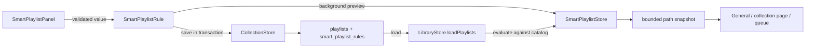

# Smart playlists: using and implementing saved rules

A regular playlist stores an ordered list of file paths. A smart playlist stores a rule and computes its current paths from the catalog. This distinction is the central design decision: changing a track's tags can change a smart playlist without rewriting any playlist membership rows.

## Use it

1. Choose **+ → Create smart playlist…** in the library, or **Create → Smart playlist…** on a virtual folder.
2. Give it a name. Add any optional conditions: text, exact genre, required tags, energy/movement ranges, and minimum local plays.
3. Choose the order, availability policy, and maximum number of included tracks.
4. Press **Preview matches**. The preview reports the full matching count, the number included after the limit, and up to 20 examples.
5. Save. Open it like any other playlist. Right-click for **Edit rules**, **Refresh matches**, or **Save as regular playlist**.

All enabled conditions must match. Required tags are exact tags, compared without case using Java's `Locale.ROOT` folding. For example, `Focus, Piano` requires both tags; it does not mean either one. Text search is a literal substring search across song labels and extended metadata. Genre is an exact value, so `Classical` does not mean every genre containing that word.

Energy and movement are the existing 0–100 activity ratings. A movement range does not refer to the named movement of a classical work. Rating filters include current analyzed ratings or explicit manual ratings; unmeasured and obsolete automatic ratings are excluded. Local play counts come from the track's saved local history counter, not aggregated provider history.

**Available tracks only** uses the last scan's availability flag. It does not synchronously test drives while opening a playlist. The default rule includes the first 100 available tracks by recency. The maximum selectable limit is 5,000. This bounds path lists passed to collection pages and queues; it is not a full-library paging solution.

## Follow one rule through the code

Consider a playlist called “Quiet piano”: genre `Classical`, required tag `Piano`, energy 20–55, movement 0–40, and a limit of 75.



### 1. The rule is an immutable value

[SmartPlaylistRule](../src/sangitam/desktop/model/SmartPlaylistRule.java) is a Java record. Its constructor trims text, normalizes tags, and validates limits. Nested `Range` values validate inclusive bounds within 0–100. A null range means that rating filter is disabled.

Validation belongs in the model as well as the editor. Storage callers and JSON loading must obey the same constraints even if they never construct a Swing panel. A rule rejects reversed ranges, negative minimum plays, more than 16 required tags, and limits outside 1–5,000.

[Playlist](../src/sangitam/desktop/model/Playlist.java) now has an optional `rule`. `smart()` tests whether it exists. Existing three- and six-argument constructors still create regular playlists, keeping older callers compatible. Both playlist types expose `tracks()` as a resolved snapshot, allowing the existing playback and queue code to consume either one.

### 2. Persist the definition, not generated membership

[SmartPlaylistStore](../src/sangitam/desktop/storage/SmartPlaylistStore.java) initializes:

```sql
CREATE TABLE IF NOT EXISTS smart_playlist_rules (
    playlist_id INTEGER PRIMARY KEY,
    rule_json TEXT NOT NULL
);
```

The JSON wrapper has a version number and a typed rule. Unsupported or malformed saved rules produce an error; they do not silently become an unfiltered playlist.

[CollectionStore.createSmartPlaylist](../src/sangitam/desktop/storage/CollectionStore.java) creates the ordinary playlist identity and its rule in one transaction. Names, virtual folder placement, description, and pins continue to use the existing collection model. Smart playlists do not populate `playlist_items`.

Deleting a playlist fires a trigger that deletes its rule. Folder deletion already deletes nested playlists, so the same trigger also cleans their rules. Existing IDs and regular playlist item positions survive initialization and migration.

### 3. Evaluate with bound SQL parameters

`SmartPlaylistStore.filter` builds SQL structure from the typed rule. User text, genre, tags, and numbers are passed as prepared-statement parameters. Text escapes `%`, `_`, and backslash before the substring query so these characters remain literal.

The query joins `tracks` with optional `track_metadata`. Each required tag adds an `EXISTS` condition over `json_each(..., '$.metadata.tags')`. The payload path refers to the metadata wrapper documented in the main guide.

SQLite's built-in `lower` and `NOCASE` do not fully fold Unicode. The connection therefore registers a small `sangitam_fold` function backed by Java's `toLowerCase(Locale.ROOT)` for exact genre/tag comparisons and legacy text fallback. A test covers `Étude` versus `étude`.

Rating conditions require both `analyzed=1` and either a manual override or a current analysis version. This matches the catalog's interpretation of usable ratings. Otherwise an old automatic score could qualify while the screen showed the track as unmeasured.

Every order includes stable title/artist/path tie breakers. A track limit is bound to the query. Neither the preview nor resolution needs to decode music or inspect the filesystem.

### 4. Preview and resolution have different result shapes

`preview(rule)` counts all matches and loads at most 20 example tracks in one read transaction. It reports `included = min(matching, rule.limit())`. The count and examples describe the same database snapshot.

`LibraryStore.loadPlaylists()` evaluates each smart rule on its read connection and loads only the limited paths. Regular playlists still read `playlist_items` in stored order. The rule evaluator is shared, preventing the preview and saved playlist from developing different matching semantics.

The SQLite progress handler checks interruption, allowing a cancelled preview to stop a long scan. The editor also uses a generation number. That second check is important: an older query can finish after a newer one even when cancellation was requested.

### 5. Refresh when catalog data changes

[MainFrame.onLibraryChanged](../src/sangitam/desktop/ui/MainFrame.java) requests a background collection reload after a catalog snapshot changes. Import, metadata edits, availability updates, and recorded local plays therefore refresh smart membership. Collection revisions reject older reload results. The library entry builder labels these playlists as Smart and uses their current members for folder membership and collection pages.

An active playback queue keeps the choices and order captured when it was started. A new qualifying song appears in the playlist on refresh; it does not unexpectedly insert itself into music already queued.

### 6. Protect rule ownership at multiple boundaries

The interface omits **Add songs** for a smart playlist and filters smart playlists out of “Add to existing playlist” destinations. Drop policy rejects a smart target. Dragging a smart source to a regular playlist copies its current songs; moving it to a folder keeps its rule.

The database layer also rejects manual appends and attempts to save a session queue over a smart playlist's name. Hiding a menu item alone would be insufficient: another caller or an outdated UI action could still reach storage.

**Save as regular playlist** makes a fixed copy of the current limited paths. Later rule or catalog changes affect the smart source and leave the copy's membership intact. A test demonstrates this difference.

## Read and run the checks

From the repository root in PowerShell:

```powershell
.\mvnw.cmd '-Dtest=SmartPlaylistStoreTest,SmartPlaylistPanelTest,SmartPlaylistLibraryTest' test
.\mvnw.cmd '-Dtest=CatalogBenchmarkTest' '-Dsangitam.catalogBenchmark=true' test
```

- `SmartPlaylistStoreTest` covers changing matches, exact tags, rating freshness, limits, literal text, round-trip persistence, regular-copy behavior, cleanup, and write protection.
- `SmartPlaylistPanelTest` covers typed number commits, validation, background previews, late-result rejection, and retry after failure.
- `SmartPlaylistLibraryTest` constructs menus and checks drop policy in memory. It does not send mouse or keyboard input to the desktop.
- `CatalogBenchmarkTest` creates 100,000 synthetic rows and measures both paged search and smart preview/resolution. It creates no audio files and opens no app windows.

The current implementation is wired into the UI and checked headlessly. Visual verification and native drag/drop interaction remain pending because desktop control was explicitly excluded. Arbitrary OR/nested rule groups, source/provider rules, duration limits, automatic queue mutation, and paging every collection page are outside this rule model.
